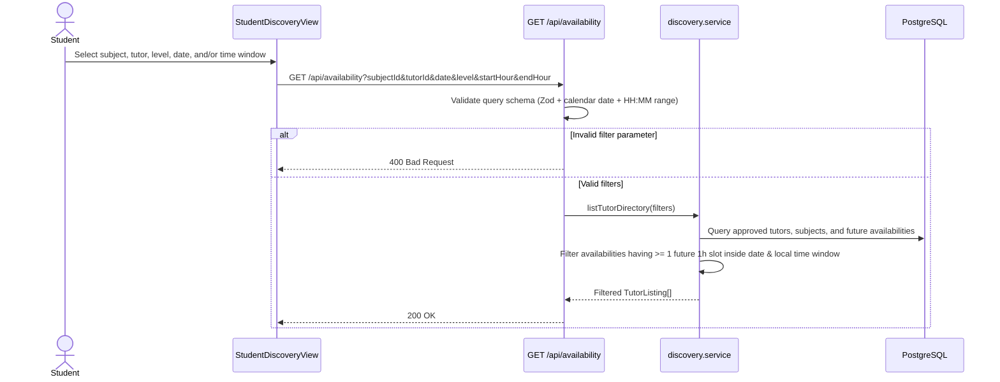
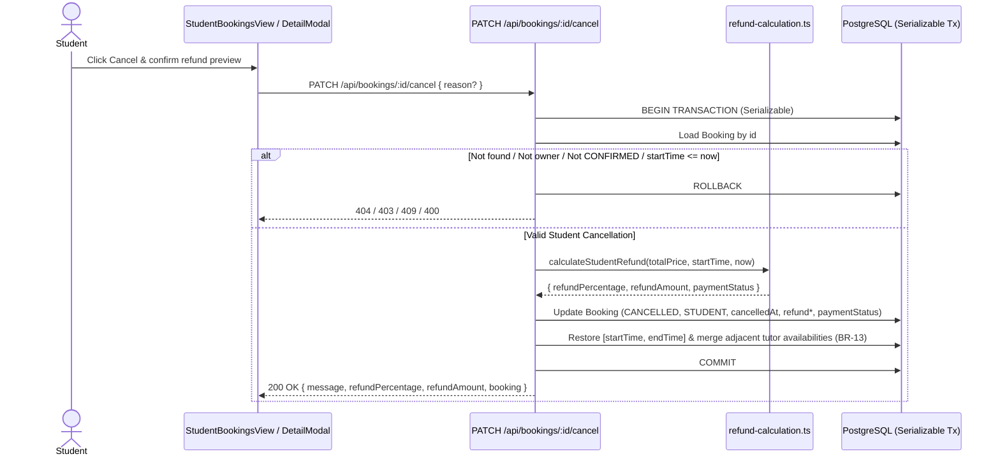
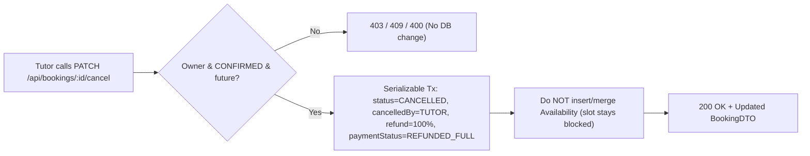
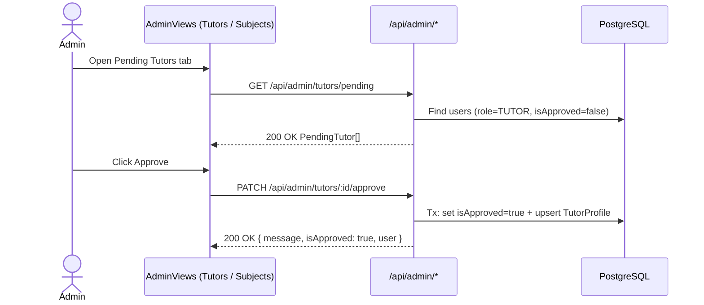

# TutorHub — Sprint 2 Feature Contracts, Acceptance Criteria & Test Specifications

**Version:** 1.0 (Pre-Implementation Baseline)  
**Date:** 2026-11-23  
**Authors:** Korapin Manoprasertkoon (`67070503458`), Phureeruch Satithangkul (`67070503471`)  
**Course:** CPE 334 — Project Deliverable 2 (Part B)  
**Baseline Preceded:** Committed on `docs/d2-contracts-and-register` prior to Sprint 2 feature implementation PRs (`F-09`–`F-15`).

---

## Global Conventions (Inherited Across All Sprint 2 Features)
- **Authentication & RBAC (`NFR-01`, `BR-03`):** All protected endpoints use `Authorization: Bearer <JWT>` (`authenticate` middleware reloads user from PostgreSQL). Role restrictions use `requireRole(...)`; resource ownership is verified server-side.
- **Error Contract:** JSON `{ "message": "<user-facing sentence>" }` with HTTP status `400` (validation/business rule), `401` (unauthenticated), `403` (forbidden role/ownership), `404` (resource not found), `409` (state/concurrency/uniqueness conflict).
- **Timezone & Money:** Local calendar dates and local time-of-day filters use **Asia/Bangkok (`UTC+7`, no DST)**; timestamps are stored and returned as ISO-8601 UTC strings. Monetary values use PostgreSQL `Decimal(10, 2)` (THB) serialized as JSON `number`.
- **Transaction Safety (`NFR-04`):** Multi-row state transitions (booking cancellation + availability restoration/merging, availability edits) execute inside `prisma.$transaction(..., { isolationLevel: 'Serializable' })`.

---

## F-09 — Advanced Search & Filter (Subject, Tutor, Level, Date & Time Window)

- **Linked Requirements:** `FR-07`, `BR-05`, `BR-06`, `NFR-02`
- **Owner:** Korapin (Issue #4)

### 1. Feature SDS & Workflow
Extends the existing public/authenticated tutor directory (`GET /api/availability`) so students can narrow open future slots by **time-of-day window** (`startHour`, `endHour` in Asia/Bangkok local time) in combination with existing filters (`subjectId`, `tutorId`, `level`, `date`).



### 2. Layer Definitions
- **Data Layer:** **No schema change.** Uses existing `User`, `TutorProfile`, `TutorSubject`, and `Availability` tables.
- **API Layer (`GET /api/availability`):**
  - Existing query params: `subjectId` (pos int), `tutorId` (pos int), `date` (`YYYY-MM-DD`), `level` (`HIGH_SCHOOL | UNDERGRADUATE | GRADUATE`).
  - **New Sprint 2 query params:**
    - `startHour`: optional string `HH:MM` on `:00` or `:30` (`00:00`–`23:30`, Bangkok time).
    - `endHour`: optional string `HH:MM` on `:00` or `:30` (`00:30`–`24:00`, Bangkok time).
  - Slot matching rule: an `Availability` block matches if it contains at least one aligned 1-hour future slot `[slotStart, slotStart + 1h)` whose Bangkok local start time is `>= startHour` (when provided) and local end time is `<= endHour` (when provided). When `date`, `startHour`, or `endHour` is active, tutors with zero matching availabilities are excluded from the returned list.
- **UI Layer (`client/src/components/student/StudentDiscoveryView.tsx`):**
  - Add "From time" (`startHour`) and "To time" (`endHour`) select controls alongside existing Subject pills, Tutor dropdown, Level dropdown, and Date input.
  - "Clear filters" resets all 6 filters (`subjectId`, `tutorId`, `level`, `date`, `startHour`, `endHour`) and displays contextual empty-state text when no slots match.

### 3. Validation, Boundaries & Permissions
- **Access:** Public / Authenticated (returns only approved tutors `isApproved === true`; never exposes tutor email or private student bookings).
- **Validation & Errors:**
  - Malformed `startHour`/`endHour` (not `HH:00`/`HH:30`, out of `00:00`–`24:00`) → `400 "Invalid discovery filters."`
  - Both `startHour` and `endHour` supplied with `endHour <= startHour` (or span `< 1 hour`) → `400 "End time must be at least 1 hour after start time."`
  - Invalid calendar `date` (e.g., `2026-02-30`) → `400 "Invalid date."`

### 4. Numbered Acceptance Criteria
- **AC-09.1:** Filtering by `startHour` and/or `endHour` returns only tutors and availability blocks containing at least one aligned future 1-hour bookable slot within the requested Bangkok local time window.
- **AC-09.2:** Combining `subjectId`, `tutorId`, `level`, `date`, `startHour`, and `endHour` applies logical AND across all active filters.
- **AC-09.3:** Unapproved tutors (`isApproved = false`) never appear in `GET /api/availability` regardless of filter combinations.
- **AC-09.4:** Invalid time formats or reversed/sub-1-hour time windows (`endHour <= startHour` or `< 60 min`) are rejected with HTTP `400`.
- **AC-09.5:** Clearing filters in the Discovery UI restores the full directory of approved tutors with open future slots.

### 5. System Test Specification (STS)

| Test ID | Level | Linked AC | Preconditions & Inputs | Expected Outcome |
|---|---|---|---|---|
| **STS-09.1** | API/DB Integration | AC-09.1 | Tutor A has future availability `09:00–12:00` ICT; Tutor B has `14:00–16:00` ICT. Call `GET /api/availability?startHour=13:00&endHour=17:00`. | `200 OK`; returns Tutor B only with `14:00–16:00`; Tutor A excluded. |
| **STS-09.2** | API/DB Integration | AC-09.2 | Call `GET /api/availability?subjectId=<Python>&level=UNDERGRADUATE&date=<d>&startHour=09:00&endHour=12:00`. | `200 OK`; returns only approved tutors teaching Python at Undergraduate level with open slot on `<d>` within `09:00–12:00` ICT. |
| **STS-09.3** | API/DB Integration | AC-09.3 | Unapproved tutor exists with future availability matching filters. Call `GET /api/availability`. | `200 OK`; unapproved tutor is absent from results. |
| **STS-09.4** | API/DB Integration | AC-09.4 | Call `GET /api/availability?startHour=15:00&endHour=14:00` and `?startHour=09:15`. | Both return `400 Bad Request` with clear user-facing error message. |
| **STS-09.5** | UI Component (Vitest) | AC-09.1, AC-09.5 | Render `StudentDiscoveryView`, pick time filter yielding no matches, verify empty notice, click "Clear filters". | Empty state renders; clearing filters restores all tutors. |

### 6. Definition of Done (F-09)
- Backend route, service, `httpClient.ts`, `mockApi.ts`, and `StudentDiscoveryView.tsx` updated.
- STS-09.1 through STS-09.5 implemented and passing in CI (`test-and-docker`).
- Reviewed via teammate PR and merged into `sprint-2-staging`.

---

## F-10 — Student Cancellation & 3-Tier Refund Calculation

- **Linked Requirements:** `FR-12`, `BR-10`, `BR-11`, `BR-13`, `BR-15`, `NFR-01`, `NFR-02`, `NFR-04`
- **Owner:** Phureeruch (Issue #3)

### 1. Feature SDS & Workflow
Allows a Student to cancel their own `CONFIRMED` future booking. Inside a single `Serializable` transaction, the system computes the BR-11 refund tier from `startTime - now`, updates the booking's cancellation/refund audit fields (`BR-15`), and restores + merges the released time interval back into the tutor's availability (`BR-13` / `F-12`). Confirmed booking schedule fields remain immutable (`BR-10`).



### 2. Layer Definitions
- **Data Layer:** **No Prisma schema migration required.** `Booking` already defines `status` (`BookingStatus.CANCELLED`), `paymentStatus` (`SUCCESS | REFUNDED_PARTIAL | REFUNDED_FULL`), `cancelledBy` (`Role?`), `cancelledAt` (`DateTime?`), `refundPercentage` (`Int?`), and `refundAmount` (`Decimal?`). PostgreSQL GiST overlap constraints already exclude `WHERE (status <> 'CANCELLED')`.
- **API Layer (`PATCH /api/bookings/:id/cancel`):**
  - Request body: `{ reason?: string }` (optional; if provided, trimmed string, max 300 chars).
  - Response `200 OK`:
    ```json
    {
      "message": "Booking cancelled successfully.",
      "refundPercentage": 50,
      "refundAmount": 400,
      "booking": { "...BookingDTO with CANCELLED status & audit fields..." }
    }
    ```
  - **BR-10 Immutability:** No `PUT /api/bookings/:id` or `PATCH /api/bookings/:id` schedule-editing endpoint exists; attempts to mutate schedule fields on a confirmed booking are unsupported (`404`/`405`).
- **UI Layer:**
  - `StudentBookingsView.tsx` & `BookingDetailModal.tsx`: display "Cancel booking" button only for `CONFIRMED` bookings with `startTime > now`.
  - Confirmation modal shows exact computed refund tier (`100%`, `50%`, or `0%`) and THB refund amount before submitting, plus BR-10 note ("Confirmed lessons cannot be rescheduled; cancel and book a new slot instead").
  - Cancelled bookings remain visible in the booking list and detail modal showing `CANCELLED`, who cancelled, timestamp, refund percentage, and refund amount (`BR-15`).

### 3. Validation, Boundaries & Permissions
- **Refund Tier Boundaries (`BR-11`):** Let `remainingMs = startTime.getTime() - now.getTime()`:
  - `remainingMs <= 0` → reject `400 "You can only cancel a booking before the lesson starts."`
  - `remainingMs >= 72 * 3600 * 1000` (exact `72h` inclusive) → `100%`, `refundAmount = totalPrice`, `paymentStatus = REFUNDED_FULL`.
  - `24 * 3600 * 1000 <= remainingMs < 72 * 3600 * 1000` (exact `24h` inclusive) → `50%`, `refundAmount = roundHalfUp2(totalPrice * 0.5)`, `paymentStatus = REFUNDED_PARTIAL`.
  - `0 < remainingMs < 24 * 3600 * 1000` → `0%`, `refundAmount = 0`, `paymentStatus = SUCCESS`.
- **Status & Access Errors:**
  - Missing booking ID → `404 "Booking not found."`
  - Authenticated user is another `STUDENT`, another `TUTOR`, or `ADMIN` (not the booking's student or tutor) → `403 "You are not allowed to cancel this booking."`
  - Booking status is already `CANCELLED` or `COMPLETED` → `409 "Only confirmed bookings can be cancelled."`

### 4. Numbered Acceptance Criteria
- **AC-10.1:** Cancelling `>= 72` hours before `startTime` (including exactly `72h 00m 00s`) grants `100%` refund (`paymentStatus = REFUNDED_FULL`).
- **AC-10.2:** Cancelling between `24` hours (inclusive) and `< 72` hours before `startTime` (including `71h 59m 59s` and `24h 00m 00s`) grants `50%` refund (`paymentStatus = REFUNDED_PARTIAL`).
- **AC-10.3:** Cancelling `< 24` hours before `startTime` (e.g., `23h 59m 59s`) grants `0%` refund (`refundAmount = 0`, `paymentStatus = SUCCESS`).
- **AC-10.4:** Cancelling at or after `startTime` (`remainingMs <= 0`), or cancelling a non-`CONFIRMED` booking, is rejected without modifying DB state.
- **AC-10.5:** A Student attempting to cancel another student's booking receives `403 Forbidden`, and DB state remains unchanged.
- **AC-10.6:** Upon Student cancellation, the released interval is atomically restored and merged with adjacent availability blocks (`BR-13`), and the booking record retains full cancellation/refund audit fields (`BR-15`).
- **AC-10.7:** Confirmed bookings cannot have their tutor, subject, date, start time, or duration modified directly (`BR-10`); rebooking requires cancelling and creating a new booking.

### 5. System Test Specification (STS)

| Test ID | Level | Linked AC | Preconditions & Inputs | Expected Outcome |
|---|---|---|---|---|
| **STS-10.1** | Unit | AC-10.1, AC-10.2, AC-10.3, AC-10.4 | Test `calculateStudentRefund` at `72h00m`, `71h59m59s`, `24h00m`, `23h59m59s`, `0s`, `-1m` with `totalPrice = 750`. | Returns `100% (750)`, `50% (375)`, `50% (375)`, `0% (0)`, and rejects `<= 0` with validation error. |
| **STS-10.2** | API/DB Integration | AC-10.1, AC-10.6 | Student owns confirmed booking `>= 72h` away carved out of `[09:00–12:00]` (leaving `[09:00–10:00]` and `[11:00–12:00]`). Call `PATCH /api/bookings/:id/cancel`. | `200 OK`; DB shows `CANCELLED`, `cancelledBy=STUDENT`, `refundPercentage=100`, `paymentStatus=REFUNDED_FULL`; tutor availability merged back to single `[09:00–12:00]` row. |
| **STS-10.3** | API/DB Integration | AC-10.2, AC-10.3 | Student cancels one booking `36h` ahead and another `12h` ahead. | First persists `50% / REFUNDED_PARTIAL`; second persists `0% / SUCCESS`; both restore tutor availability. |
| **STS-10.4** | API/DB Integration | AC-10.4 | Student calls `PATCH /api/bookings/:id/cancel` on (a) past-start booking, (b) already-cancelled booking. | Returns `400` for past booking and `409` for already-cancelled; DB unchanged. |
| **STS-10.5** | API/DB Integration | AC-10.5 | Student B calls `PATCH /api/bookings/:id/cancel` on Student A's booking. | Returns `403 Forbidden`; booking stays `CONFIRMED`. |
| **STS-10.6** | API/DB Integration | AC-10.7 | Attempt `PUT /api/bookings/:id` or `PATCH /api/bookings/:id` to change `startTime`/`durationHours`. | Rejected (`404`); confirmed schedule remains immutable; student can cancel and rebook the released slot. |
| **STS-10.7** | UI Component (Vitest) | AC-10.1, AC-10.6 | Render `StudentBookingsView`, open cancel confirmation modal, verify refund preview text, confirm cancel. | Calls cancel action, displays `CANCELLED` badge and refund summary. |

### 6. Definition of Done (F-10)
- TDD red commits precede implementation commits for refund boundaries and cancellation API.
- STS-10.1 through STS-10.7 passing in CI; UI adheres to `docs/STYLE_GUIDE.md`.
- Teammate-reviewed PR merged to `sprint-2-staging`.

---

## F-11 — Tutor Booking Cancellation Handling

- **Linked Requirements:** `FR-12`, `BR-12`, `BR-15`, `NFR-01`, `NFR-02`, `NFR-04`
- **Owner:** Phureeruch (Issue #3)

### 1. Feature SDS & Workflow
Allows the assigned Tutor to cancel a `CONFIRMED` future booking via `PATCH /api/bookings/:id/cancel`. Regardless of how close the lesson is, the Student receives a `100%` refund (`REFUNDED_FULL`), audit fields record `cancelledBy = TUTOR`, and the cancelled time period stays **permanently blocked** (never restored to `Availability` per `BR-12`).



### 2. Layer Definitions
- **Data Layer:** **No schema change.** Uses existing `Booking` audit columns.
- **API Layer:** Shared endpoint `PATCH /api/bookings/:id/cancel` branching on authenticated user role (`TUTOR` with `booking.tutorId === user.id`). Returns `200 OK { message, refundPercentage: 100, refundAmount: totalPrice, booking }`.
- **UI Layer (`TutorDashboardView.tsx` Appointments & `BookingDetailModal.tsx`):**
  - Display "Cancel appointment" button on `CONFIRMED` future bookings.
  - Confirmation modal explicitly warns: *"The student will receive a 100% refund, and this time slot will remain blocked (not reopened for booking)."*
  - Cancelled appointment remains in Tutor, Student, and Admin lists with `Cancelled by tutor` + `100% refunded` indicator (`BR-15`).

### 3. Validation, Boundaries & Permissions
- **Permissions:** Only the assigned Tutor (`booking.tutorId === user.id`) may execute the tutor cancellation path. Another tutor receives `403 Forbidden`.
- **Boundaries:** Even if `remainingMs` is `< 24h` (e.g., 1 hour before lesson), tutor cancellation always sets `refundPercentage = 100` and `refundAmount = totalPrice`.
- **Errors:** `404` missing booking, `403` non-assigned tutor, `400` lesson already started (`startTime <= now`), `409` booking not `CONFIRMED`.

### 4. Numbered Acceptance Criteria
- **AC-11.1:** Assigned Tutor can cancel a `CONFIRMED` future booking at any time before `startTime` (including `< 24h` prior) and the student receives `100%` refund (`paymentStatus = REFUNDED_FULL`, `cancelledBy = TUTOR`).
- **AC-11.2:** Tutor cancellation does **not** restore or merge the cancelled interval into `Availability`; students cannot rebook that time slot.
- **AC-11.3:** Another Tutor attempting to cancel a booking they do not own receives `403 Forbidden`.
- **AC-11.4:** Past-start or non-`CONFIRMED` bookings cannot be cancelled by a Tutor (`400`/`409`).
- **AC-11.5:** Cancelled booking audit fields (`cancelledBy`, `cancelledAt`, `refundPercentage`, `refundAmount`) persist in PostgreSQL and display for Student, Tutor, and Admin (`BR-15`).

### 5. System Test Specification (STS)

| Test ID | Level | Linked AC | Preconditions & Inputs | Expected Outcome |
|---|---|---|---|---|
| **STS-11.1** | API/DB Integration | AC-11.1, AC-11.2, AC-11.5 | Assigned Tutor cancels a `CONFIRMED` booking starting `4h` from now (`totalPrice = 400`). | `200 OK`; `refundPercentage=100`, `refundAmount=400`, `paymentStatus=REFUNDED_FULL`, `cancelledBy=TUTOR`; `Availability` table has zero restored rows for that interval; `POST /api/bookings` for that interval fails with `409`. |
| **STS-11.2** | API/DB Integration | AC-11.3 | Tutor B calls `PATCH /api/bookings/:id/cancel` on Tutor A's booking. | `403 Forbidden`; booking stays `CONFIRMED`. |
| **STS-11.3** | API/DB Integration | AC-11.4 | Assigned Tutor cancels (a) past booking, (b) already-cancelled booking. | Returns `400` and `409` respectively; DB unchanged. |
| **STS-11.4** | UI Component (Vitest) | AC-11.1, AC-11.5 | Render `TutorDashboardView` (appointments), click Cancel, verify 100%-refund & blocked-slot warning, confirm. | Booking updates to `CANCELLED` with refund details; slot does not reappear in open availability chips. |

### 6. Definition of Done (F-11)
- Backend, frontend, and STS-11.1 through STS-11.4 complete and passing in CI.
- Verified end-to-end that blocked time stays unbookable in Discovery.

---

## F-12 — Tutor Availability Management & Interval Merging

- **Linked Requirements:** `FR-06`, `BR-04`, `BR-13`, `NFR-01`, `NFR-04`
- **Owner:** Phureeruch (Issue #3)

### 1. Feature SDS & Workflow
Completes full CRUD management of tutor availability (`FR-06`) by adding interval updating (`PUT /api/tutor/availability/:id`) and implementing automatic adjacent-interval merging (`mergeAdjacentIntervals()` in `availability.service.ts`) whenever:
1. A Student cancels a booking (`F-10` / `BR-13`), releasing `[B_start, B_end]` next to existing open windows of the same tutor.
2. A Tutor creates (`POST`) or updates (`PUT`) an availability window that touches an existing open window (`endTime === other.startTime` or `startTime === other.endTime`).

### 2. Layer Definitions
- **Data Layer:** **No schema change.** Uses existing `Availability` model with `@@index([tutorId, startTime, endTime])`.
- **API Layer:**
  - `POST /api/tutor/availability` (enhanced): if new valid window touches existing open availability of the same tutor, merges them atomically and returns the merged `Availability` (`201`).
  - **New `PUT /api/tutor/availability/:id`** (`TUTOR` role, ownership required):
    - Request: `{ startTime: ISO8601, endTime: ISO8601 }`.
    - Validates `BR-04` (`>= 1h`, whole hours, `:00`/`:30` start, future start), ensures no overlap with any other availability or non-cancelled booking of this tutor, replaces the window, and merges with any newly adjacent availability blocks inside a `Serializable` transaction.
    - Response `200 OK`: updated (or merged) `Availability` object.
  - Internal helper `restoreAndMergeAvailability(tx, tutorId, startTime, endTime)`: finds all `Availability` rows for `tutorId` where `endTime === startTime` OR `startTime === endTime`, deletes them, and inserts one consolidated row `[minStart, maxEnd]`.
- **UI Layer (`TutorDashboardView.tsx` Availability section):**
  - Add an inline **Edit** action next to **Remove** on each open availability chip allowing the tutor to adjust date/start/duration via `PUT /api/tutor/availability/:id`.
  - Schedule `TimeTrack` immediately reflects merged continuous blocks (e.g., `09:00–12:00` instead of separate adjacent fragments).

### 3. Validation, Boundaries & Permissions
- **Access:** Requires `TUTOR` role, approved account (`isApproved === true`), and resource ownership (`availability.tutorId === user.id`, else `403`).
- **Boundaries & Errors:**
  - `404 "Availability not found."` when ID does not exist.
  - `403 "You can only edit your own availability."` for another tutor; `403` for Student/Admin.
  - `400` when violating `BR-04` (non-whole hour, not `:00`/`:30`, past start time, overlaps another open availability or non-cancelled booking).
  - Adjacent windows (`[09:00, 10:00]` and `[10:00, 12:00]`) are **touching, not overlapping** — they merge into `[09:00, 12:00]`, whereas overlapping intervals (`[09:00, 11:00]` and `[10:00, 12:00]`) are rejected with `400`.
  - Merging strictly scopes by `tutorId` (never merges across different tutors).

### 4. Numbered Acceptance Criteria
- **AC-12.1:** `mergeAdjacentIntervals()` merges left-adjacent, right-adjacent, and double-sided adjacent intervals (e.g., `[09:00–10:00] + [10:00–11:00] + [11:00–12:00]` → `[09:00–12:00]`) while leaving non-adjacent intervals separate.
- **AC-12.2:** Student cancellation of a middle booking restores and merges adjacent open intervals back into one continuous block (`BR-13`) so a student can book across the full merged window.
- **AC-12.3:** Creating or updating a tutor availability window adjacent to an existing open window automatically merges them into one row.
- **AC-12.4:** Tutor can update an open availability window via `PUT /api/tutor/availability/:id` subject to `BR-04` and non-overlap checks; non-owners receive `403`.
- **AC-12.5:** Interval merging never crosses tutor boundaries.

### 5. System Test Specification (STS)

| Test ID | Level | Linked AC | Preconditions & Inputs | Expected Outcome |
|---|---|---|---|---|
| **STS-12.1** | Unit | AC-12.1 | Call `mergeAdjacentIntervals()` with: (a) left-adjacent, (b) right-adjacent, (c) bridge between two blocks, (d) 1-hour gap, (e) unsorted input. | Produces exact minimal sorted merged intervals; gap intervals stay separate. |
| **STS-12.2** | API/DB Integration | AC-12.2, AC-12.5 | Tutor A has `[09:00–10:00]` & `[11:00–12:00]`; Tutor B has `[10:00–11:00]`. Student cancels Tutor A's `[10:00–11:00]` booking. | Tutor A has single `[09:00–12:00]` availability; Tutor B's `[10:00–11:00]` is untouched; a new 3h booking `09:00–12:00` for Tutor A succeeds. |
| **STS-12.3** | API/DB Integration | AC-12.3, AC-12.4 | Tutor creates `[13:00–14:00]`, then creates adjacent `[14:00–16:00]`, then calls `PUT /api/tutor/availability/:id` to shift to `[13:30–15:30]`. | Adjacent create merges to `[13:00–16:00]`; `PUT` updates cleanly; invalid `:15` or booking-overlapping `PUT` returns `400`. |
| **STS-12.4** | API/DB Integration | AC-12.4 | Tutor B calls `PUT /api/tutor/availability/:id` on Tutor A's availability. | Returns `403 Forbidden`; DB unchanged. |

### 6. Definition of Done (F-12)
- `mergeAdjacentIntervals` utility, `PUT /api/tutor/availability/:id`, frontend edit UI, and STS-12.1–STS-12.4 implemented and passing in CI.

---

## F-13 — Admin Tutor Account Approval & Subject Catalog Management

- **Linked Requirements:** `FR-02`, `FR-05`, `BR-02`, `BR-03`, `NFR-01`
- **Owner:** Korapin (Issue #4)

### 1. Feature SDS & Workflow
Expands `/api/admin` beyond summary metrics so Admins can inspect pending Tutor accounts, approve them (making them discoverable and able to publish availability), and create/update master subjects in the catalog.



### 2. Layer Definitions
- **Data Layer:** **No Prisma schema migration required.** (`User.isApproved`, `TutorProfile`, and `Subject` already exist.) Update `server/prisma/seed.ts` to seed one idempotent pending tutor (`evan.pending@tutorhub.dev`, `role: 'TUTOR'`, `isApproved: false`) so approval can be verified out of the box (`DEF-07`).
- **API Layer (All endpoints require `authenticate` + `requireRole('ADMIN')`):**
  - `GET /api/admin/tutors/pending` → `200 OK`: array of `{ id, name, email, role, isApproved, createdAt, bio }` ordered by `createdAt asc`.
  - `PATCH /api/admin/tutors/:id/approve` → `200 OK`: `{ message: "Tutor approved successfully.", isApproved: true, user: UserPublic }`. Upserts an empty `TutorProfile` if none exists so the newly approved tutor can immediately edit their profile.
  - `POST /api/admin/subjects` → Request `{ name: string, description?: string | null }`. Response `201 Created`: created `Subject` (`{ id, name, description, createdAt }`).
  - `PUT /api/admin/subjects/:id` → Request `{ name: string, description?: string | null }`. Response `200 OK`: updated `Subject`.
  - **Enforcement on Tutor Availability (`BR-02`):** `POST /api/tutor/availability` and `PUT /api/tutor/availability/:id` verify `user.isApproved === true`, rejecting unapproved tutors with `403 "Your tutor account is pending administrator approval."`
- **UI Layer:**
  - Add Admin sub-navigation in `AppNavbar.tsx` and routes in `routes.ts`:
    - `/admin/bookings` (existing `AdminBookingsView.tsx`)
    - `/admin/tutors` (new `AdminTutorsView.tsx`: pending tutor queue with Approve button + confirmation notice)
    - `/admin/subjects` (new `AdminSubjectsView.tsx`: subject catalog list + Add/Edit subject form)
  - All views styled using `docs/STYLE_GUIDE.md` tokens.

### 3. Validation, Boundaries & Permissions
- **RBAC (`BR-03`, `NFR-01`):** `STUDENT` and `TUTOR` tokens calling any `/api/admin/*` route receive `403 Forbidden`; unauthenticated requests receive `401 Unauthorized`.
- **Tutor Approval Errors:** Non-integer/invalid ID → `400`; user not found or user `role !== 'TUTOR'` → `404 "Tutor account not found."`; approving an already-approved tutor is idempotent (`200`).
- **Subject Catalog Validation:**
  - `name` trimmed, required, `2..80` characters → else `400 "Subject name must be between 2 and 80 characters."`
  - `description` optional, trimmed, max `300` characters (`""` stored as `null`) → else `400`.
  - Duplicate subject name (case-insensitive match against existing `Subject.name`) → `409 "A subject with this name already exists."`

### 4. Numbered Acceptance Criteria
- **AC-13.1:** Admin can list all pending (`isApproved = false`) Tutor accounts via `GET /api/admin/tutors/pending` and the Admin Tutors UI.
- **AC-13.2:** Admin can approve a pending Tutor via `PATCH /api/admin/tutors/:id/approve`; the tutor's `isApproved` persists as `true`, a `TutorProfile` exists, and the tutor can publish availability and appear in student discovery.
- **AC-13.3:** Unapproved tutors cannot publish availability (`403`) and do not appear in `GET /api/tutors` or `GET /api/availability`.
- **AC-13.4:** Admin can add and update subjects in the master catalog (`POST/PUT /api/admin/subjects`); new subjects immediately appear in `GET /api/subjects`, tutor profile selection, and student discovery filters.
- **AC-13.5:** Duplicate subject names (case-insensitive) are rejected with `409 Conflict`; blank or oversized names return `400 Bad Request`.
- **AC-13.6:** Any Student or Tutor calling `/api/admin/tutors/pending`, `/api/admin/tutors/:id/approve`, or `/api/admin/subjects` is rejected with `403 Forbidden`.

### 5. System Test Specification (STS)

| Test ID | Level | Linked AC | Preconditions & Inputs | Expected Outcome |
|---|---|---|---|---|
| **STS-13.1** | API/DB Integration | AC-13.1, AC-13.2, AC-13.3 | Pending tutor exists (`isApproved=false`). (1) Pending tutor tries `POST /api/tutor/availability`. (2) Admin calls `GET /api/admin/tutors/pending`, then `PATCH /api/admin/tutors/:id/approve`. (3) Approved tutor updates profile & creates availability. (4) Student queries `GET /api/availability`. | Step 1 returns `403`; Step 2 returns `200` and persists `isApproved=true`; Step 3 succeeds; Step 4 includes the newly approved tutor. |
| **STS-13.2** | API/DB Integration | AC-13.2 | Admin calls `PATCH /api/admin/tutors/<studentId>/approve` and `/999999/approve`. | Both return `404 Not Found`. |
| **STS-13.3** | API/DB Integration | AC-13.4, AC-13.5 | Admin calls `POST /api/admin/subjects` with `{ name: "Discrete Math", description: "Logic and graphs" }`, then repeats with `"discrete math"`, then `PUT /api/admin/subjects/:id`. | First returns `201` and appears in `GET /api/subjects`; duplicate returns `409`; `PUT` returns `200` with updated fields. |
| **STS-13.4** | API/DB Integration | AC-13.6 | Student token and Tutor token each call `GET /api/admin/tutors/pending`, `PATCH /api/admin/tutors/:id/approve`, and `POST /api/admin/subjects`. | Every request returns `403 Forbidden`; DB unchanged. |
| **STS-13.5** | UI Component (Vitest) | AC-13.1, AC-13.4 | Render `AdminTutorsView` (approve pending tutor) and `AdminSubjectsView` (create subject). | Pending tutor disappears from queue with success banner; new subject appears in catalog table. |

### 6. Definition of Done (F-13)
- Backend routes/services, `seed.ts` pending tutor, Admin UI tabs, and STS-13.1–STS-13.5 passing in CI.

---

## F-14 — Docker Containerization & Cloud Deployment (GCP)

- **Linked Requirements:** `NFR-03`, `NFR-05`
- **Owner:** Korapin & Phureeruch (Implemented in Lab 5; hardened & verified in Issue #5 & Issue #7)

### 1. Feature SDS & Workflow
Packages TutorHub into a reproducible multi-stage production container (`Dockerfile`: React Vite build + Express 5 API serving static SPA on port `3000`) and a 4-service local Docker Compose stack (`db`, `migrate`, `server`, `client`). Production deploys to **Google Cloud Run** (`tutorhub`, region `asia-southeast1`) backed by **Cloud SQL PostgreSQL 16** (`tutorhub-pg`), **Artifact Registry**, **Cloud Run Migration Job** (`tutorhub-migrate`), and **Secret Manager** (no baked secrets).

### 2. Layer Definitions
- **UI Layer:** **No change** (built SPA served statically by Express in production, or Nginx in local Compose).
- **API Layer:** **No new business endpoints** (retains Lab 5 `/api/health`, `/api/ready`, and PostgreSQL `BYTEA` attachment storage).
- **Data / Ops Layer:** Keeps `Dockerfile`, `docker-compose.yml`, `deploy/deploy.sh`, `deploy/release.sh`, `deploy/smoke_test.py`, and `docs/labs/lab-05/deployment.md` current; reconciles `README.md` (`DEF-06`).

### 3. Validation, Boundaries & Permissions
- Production startup rejects missing `ADMIN_PASSWORD` or `JWT_SECRET` (fail-fast).
- All secrets reside in GCP Secret Manager (`tutorhub-database-url`, `tutorhub-jwt-secret`, `tutorhub-admin-password`, `tutorhub-demo-password`); zero secrets in Git or Docker image layers.
- Database persistence must survive container restarts (`docker compose down && docker compose up -d` without `-v`) and Cloud Run revision rollouts.

### 4. Numbered Acceptance Criteria
- **AC-14.1:** Unified production `Dockerfile` builds cleanly and serves both SPA routes and `/api/*` endpoints.
- **AC-14.2:** Local `docker compose up --build -d` brings up healthy `db`, completes `migrate` with exit code `0`, and persists newly created records across `docker compose down && docker compose up -d`.
- **AC-14.3:** Cloud Run production deployment (`tutorhub`) runs the exact submitted Git commit SHA image tag and passes `deploy/smoke_test.py` (`/api/health`, `/api/ready`, `/`, `/api/subjects`).
- **AC-14.4:** Post-deployment persistence verification on the live GCP URL confirms written records survive page reload and re-query.
- **AC-14.5:** `README.md` and `docs/labs/lab-05/deployment.md` accurately document dependencies, env var names/examples, Docker, migration/seed, test, and deployment procedures with no real secrets.

### 5. System Test Specification (STS)

| Test ID | Level | Linked AC | Preconditions & Inputs | Expected Outcome |
|---|---|---|---|---|
| **STS-14.1** | CI / Container Build | AC-14.1 | Run `docker build -t tutorhub:latest .` in CI (`ci-docker.yml`). | Exits `0`; multi-stage image builds cleanly. |
| **STS-14.2** | Deploy Script Unit | AC-14.3 | Run `bash -n deploy/*.sh`, `test_deploy_stub.sh`, `test_release_stub.sh`, `test_smoke.py`. | All offline script & smoke unit tests pass (`0` failures). |
| **STS-14.3** | Live Post-Deploy Check | AC-14.3, AC-14.4 | Run `python3 deploy/smoke_test.py <SERVICE_URL>`, inspect Cloud Run active revision tag, and execute create + re-query check on live app. | Smoke test passes; active Cloud Run image tag equals submitted 40-char commit SHA; created data persists. |

### 6. Definition of Done (F-14)
- STS-14.1 through STS-14.3 pass on the Sprint 2 release (`v2.0.0-sprint2`) and D2 candidate (`v2.1.0-d2-rc`); `README.md` synced.

---

## F-15 — CI/CD Pipeline (GitHub Actions) & Cross-Feature Admin Metrics Check

- **Linked Requirements:** `NFR-05`, `FR-11`, `BR-15`
- **Owner:** Phureeruch (Implemented in Lab 5; hardened in Issue #5)

### 1. Feature SDS & Workflow
Automates quality gates on every PR via `.github/workflows/ci-docker.yml` (`test-and-docker`: deploy script tests, PostgreSQL 15 service container with Prisma generate/migrate/seed/tests/build, frontend lint/tests/build, and production Docker build) and automates keyless Workload Identity Federation (WIF) Cloud Run deployment on `main` via `.github/workflows/deploy.yml`.

### 2. Layer Definitions
- **UI Layer:** **No layout change** (`client/src/components/admin/adminSummary.ts` aligned with backend retained-revenue calculation per `DEF-08`).
- **API Layer:** `GET /api/admin/summary` (`server/src/services/admin.service.ts`) updated per `DEF-08` so `mockRevenue` reflects actual net retained payments (`SUM(totalPrice - COALESCE(refundAmount, 0))`) rather than dropping 50%/0%-refunded student cancellations.
- **Data Layer:** **No schema change.**
- **CI/CD Layer (`.github/workflows/ci-docker.yml`):**
  - Add `sprint-2-staging` and `sprint-3-staging` to `on.pull_request.branches`.
  - Add `npm run lint` to the frontend step (`DEF-05`).

### 3. Validation, Boundaries & Permissions
- `deploy.yml` executes deployment **only** after `test-and-docker` succeeds (except explicit 40-char SHA rollback).
- Workflow job ID (`test-and-docker`), environment (`demo`), and GCP variable names remain unchanged per Lab 5 conventions.

### 4. Numbered Acceptance Criteria
- **AC-15.1:** Opening or updating a PR targeting `sprint-2-staging`, `sprint-3-staging`, `Lab5-staging`, or `main` automatically runs `test-and-docker` including frontend `npm run lint`, backend DB tests, frontend Vitest tests, builds, and Docker build.
- **AC-15.2:** Merging to `main` triggers `Deploy demo`, builds & pushes an image tagged with the 40-char commit SHA, executes `tutorhub-migrate`, deploys Cloud Run, and passes `smoke_test.py`.
- **AC-15.3:** `GET /api/admin/summary` reports accurate `mockRevenue` across confirmed, 100%-refunded, 50%-refunded, and 0%-refunded cancelled bookings (`DEF-08`).

### 5. System Test Specification (STS)

| Test ID | Level | Linked AC | Preconditions & Inputs | Expected Outcome |
|---|---|---|---|---|
| **STS-15.1** | CI Verification | AC-15.1 | Open Sprint 2 PR into `sprint-2-staging` and release PR into `main`. | GitHub Actions `test-and-docker` runs automatically (including `npm run lint`) and passes with green status check. |
| **STS-15.2** | CD Verification | AC-15.2 | Merge accepted release PR into `main`. | `Deploy demo` passes `test` and `deploy` jobs and logs commit SHA, image digest, URL, and passed smoke test in Job Summary. |
| **STS-15.3** | API/DB Integration | AC-15.3 | Seed/create 3 bookings (`400` confirmed, `400` cancelled at 50% refund, `400` cancelled at 0% refund, `400` cancelled at 100% refund). Call `GET /api/admin/summary` as Admin. | Returns `totalBookings = 4`, `mockRevenue = 1000` (`400 + 200 + 400 + 0`). |

### 6. Definition of Done (F-15)
- `ci-docker.yml` updated (`DEF-05`), `admin.service.ts` + `adminSummary.ts` updated (`DEF-08`), STS-15.1–STS-15.3 passing, and `v2.0.0-sprint2` tagged on `main`.

---

## Contract Revision History

| Version | Date | Author(s) | Summary |
|---|---|---|---|
| 1.0 | 2026-11-23 | Korapin, Phureeruch | Initial pre-implementation Sprint 2 contracts (`F-09`–`F-15`) committed prior to feature branches and TDD tests. |
