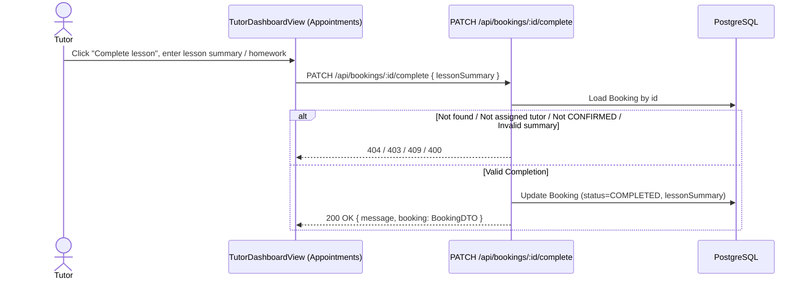
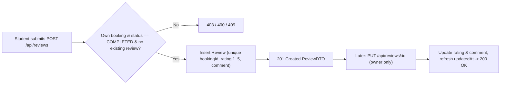

# TutorHub — Sprint 3 Feature Contracts, Acceptance Criteria, Test Specifications & Remaining-Work Plan

**Version:** 1.0 (Pre-Implementation Baseline)  
**Date:** 2026-11-23  
**Authors:** Korapin Manoprasertkoon (`67070503458`), Phureeruch Satithangkul (`67070503471`)  
**Course:** CPE 334 — Project Deliverable 2 (Part C) & Final Delivery (13 December 2026)  
**Deliverable 2 Target:** Complete contracts for all remaining Sprint 3 features (`F-16`–`F-19`) and implement + verify **F-16 (Tutor Lesson Completion & Homework Notes)** in the integrated Deliverable 2 candidate (`v2.1.0-d2-rc`) prior to 29 November 2026.

---

## Status Legend
Every feature and requirement uses strict status labels that are updated only when backed by actual commits and executed verification:
- **Planned:** Contract, AC, and STS defined; implementation not yet started.
- **In Progress:** Active feature branch exists; implementation or testing incomplete.
- **Implemented:** Code exists on branch/staging, but full STS verification has not yet run and passed.
- **Tested:** Code and automated STS tests pass on an identified commit SHA.
- **Accepted:** Reviewed PR merged to `main`, regression-checked, and included in a tagged release.

---

## F-16 — Tutor Lesson Completion & Homework Notes *(Targeted for Deliverable 2 Implementation)*

- **Linked Requirements:** `FR-13`, `BR-14`, `BR-15`, `NFR-01`, `NFR-02`, `NFR-04`
- **Owner:** Korapin (Issue #6; Reviewer: Phureeruch)
- **Current Status (as of v1.0 contract commit):** `Planned` *(Target: `Accepted` in `v2.1.0-d2-rc` by 27 Nov 2026)*

### 1. Feature SDS & Workflow
Allows the assigned Tutor to transition a `CONFIRMED` booking to `COMPLETED` while recording a lesson summary / homework note (`lessonSummary`). Once `COMPLETED`, the booking becomes permanently non-cancellable (cross-feature guard with `F-10`/`F-11`) and becomes eligible for a Student review in `F-17` (`BR-14`).



### 2. Layer Definitions
- **Data Layer:** **No Prisma schema migration required.** `Booking.lessonSummary` (`String?`) and `BookingStatus.COMPLETED` already exist in `server/prisma/schema.prisma`.
- **API Layer:**
  - **`PATCH /api/bookings/:id/complete`**
    - **Access:** Requires `authenticate` + `requireRole('TUTOR')` + ownership (`booking.tutorId === user.id`).
    - **Request:** `{ lessonSummary: string }` (trimmed, `1..2000` characters).
    - **Response (`200 OK`):**
      ```json
      {
        "message": "Lesson marked as completed.",
        "booking": { "...BookingDTO with status='COMPLETED' and lessonSummary..." }
      }
      ```
  - **Cross-Feature Rule (`F-10` / `F-11`):** `PATCH /api/bookings/:id/cancel` must reject any booking with `status === 'COMPLETED'` with `409 "Only confirmed bookings can be cancelled."`
- **UI Layer:**
  - `TutorDashboardView.tsx` (Appointments section): show **"Complete lesson"** button for `CONFIRMED` bookings; opens a modal with a textarea for `lessonSummary` (max 2000 chars, validation error on blank submit).
  - `BookingDetailModal.tsx`, `StudentBookingsView.tsx`, `TutorDashboardView.tsx`, and `AdminBookingsView.tsx`: render `COMPLETED` status pill and display the saved `lessonSummary` block ("Lesson notes & homework") whenever non-null.

### 3. Validation, Boundaries & Permissions
- **Permissions (`BR-03`, `NFR-01`):**
  - Unauthenticated → `401 Unauthorized`.
  - `STUDENT` or `ADMIN` role → `403 "Only tutors can mark lessons as completed."`
  - Another `TUTOR` (`booking.tutorId !== user.id`) → `403 "You can only complete your own appointments."`
- **Validation & State Transitions:**
  - Non-integer or missing booking ID → `404 "Booking not found."`
  - Missing, non-string, or whitespace-only `lessonSummary` → `400 "Enter a lesson summary or homework note."`
  - `lessonSummary.trim().length > 2000` → `400 "Lesson summary must be 2000 characters or fewer."`
  - Booking `status === 'CANCELLED'` or `status === 'COMPLETED'` → `409 "Only confirmed bookings can be marked as completed."`

### 4. Numbered Acceptance Criteria
- **AC-16.1:** The assigned Tutor can mark a `CONFIRMED` booking as `COMPLETED` with a valid `lessonSummary` (`1..2000` chars); changes persist in PostgreSQL.
- **AC-16.2:** The saved `COMPLETED` status and `lessonSummary` are retrieved and displayed in the booking views for the booking's Student, Tutor, and Admin.
- **AC-16.3:** Blank or `> 2000`-character `lessonSummary` values are rejected with `400 Bad Request` without changing booking state.
- **AC-16.4:** Attempting to complete a `CANCELLED` or already `COMPLETED` booking is rejected with `409 Conflict`.
- **AC-16.5:** A Student, Admin, or non-assigned Tutor attempting `PATCH /api/bookings/:id/complete` receives `403 Forbidden`.
- **AC-16.6:** Once marked `COMPLETED`, neither the Student nor the Tutor can cancel the booking (`PATCH /api/bookings/:id/cancel` returns `409`).

### 5. System Test Specification (STS)

| Test ID | Level | Linked AC | Preconditions & Inputs | Expected Outcome |
|---|---|---|---|---|
| **STS-16.1** | API/DB Integration | AC-16.1, AC-16.2 | Assigned Tutor calls `PATCH /api/bookings/:id/complete` with `{ lessonSummary: "Covered binary search trees. Homework: Ex 4.1-4.5." }`. Then Student, Tutor, and Admin call `GET /api/bookings/:id`. | `200 OK`; DB persists `status=COMPLETED` and exact `lessonSummary`; all three authorized roles retrieve the updated DTO. |
| **STS-16.2** | API/DB Integration | AC-16.3 | Assigned Tutor calls `PATCH /api/bookings/:id/complete` with `{ lessonSummary: "   " }` and with a `2001`-char string. | Both return `400 Bad Request`; booking remains `CONFIRMED`. |
| **STS-16.3** | API/DB Integration | AC-16.4 | Assigned Tutor attempts completion on (a) `CANCELLED` booking, (b) already `COMPLETED` booking. | Both return `409 Conflict`. |
| **STS-16.4** | API/DB Integration | AC-16.5 | Booking's Student, another Tutor, and Admin each call `PATCH /api/bookings/:id/complete`. | All return `403 Forbidden`; booking stays `CONFIRMED`. |
| **STS-16.5** | API/DB Integration (Cross-Feature) | AC-16.6 | After `STS-16.1`, Student and Tutor each call `PATCH /api/bookings/:id/cancel`. | Both return `409 Conflict`; `status` remains `COMPLETED` and no refund or availability restoration occurs. |
| **STS-16.6** | UI Component (Vitest) | AC-16.1, AC-16.2 | Render `TutorDashboardView` (Appointments), open Complete Lesson modal, submit notes, verify `COMPLETED` badge and notes render. | Action submits cleanly; UI displays `COMPLETED` status and saved lesson notes. |

### 6. Definition of Done (F-16)
- Backend route/service, frontend modal & read-only displays, and STS-16.1–STS-16.6 implemented and passing in CI on `main`.
- Program demonstration and API `403` evidence included in Deliverable 2 PDF (Part C & Part E).

---

## F-17 — Student Review Submission & In-Place Editing

- **Linked Requirements:** `FR-14`, `BR-14`, `BR-15`, `NFR-01`, `NFR-02`
- **Owner:** Phureeruch (Planned for Sprint 3 completion — target **Dec 5, 2026**)
- **Current Status:** `Planned`

### 1. Feature SDS & Workflow
Allows a Student to submit a single rating (`1–5` stars) and written review for their own `COMPLETED` booking (`POST /api/reviews`), and subsequently edit that review in place (`PUT /api/reviews/:id`), updating `updatedAt` while retaining the review record (`BR-14`, `BR-15`).



### 2. Layer Definitions
- **Data Layer:** **No Prisma schema migration required.** `Review` model (`id`, `bookingId @unique`, `studentId`, `rating`, `comment`, `createdAt`, `updatedAt`) already exists in `server/prisma/schema.prisma`. Include optional `review` relation summary inside `BookingDTO` (`toBookingDto`).
- **API Layer:**
  - **`POST /api/reviews`**
    - **Access:** `authenticate` + `requireRole('STUDENT')` + booking ownership (`booking.studentId === user.id`).
    - **Request:** `{ bookingId: number, rating: number, comment: string }`.
    - **Response (`201 Created`):** `{ id, bookingId, studentId, rating, comment, createdAt, updatedAt }`.
  - **`PUT /api/reviews/:id`**
    - **Access:** `authenticate` + `requireRole('STUDENT')` + review ownership (`review.studentId === user.id`).
    - **Request:** `{ rating: number, comment: string }`.
    - **Response (`200 OK`):** updated `Review` with refreshed `updatedAt`.
- **UI Layer:**
  - `StudentBookingsView.tsx` & `BookingDetailModal.tsx`: on `COMPLETED` bookings, show **"Write a review"** if `booking.review === null`, or display the existing star rating/comment with an **"Edit review"** button if a review already exists.

### 3. Validation, Boundaries & Permissions
- `rating` must be an integer in `{1, 2, 3, 4, 5}` (reject `0`, `6`, `3.5`, NaN → `400 "Rating must be a whole number from 1 to 5."`).
- `comment` trimmed, `1..1000` characters → else `400`.
- Booking not found → `404`; booking owned by another student → `403`.
- Booking `status !== 'COMPLETED'` (`CONFIRMED` or `CANCELLED`) → `400 "You can only review completed lessons."`
- Second review for same `bookingId` (`@unique` / Prisma `P2002`) → `409 "You have already reviewed this lesson. Edit your existing review instead."`
- Non-owner editing review via `PUT /api/reviews/:id` → `403 Forbidden`; missing review → `404`.

### 4. Numbered Acceptance Criteria
- **AC-17.1:** Student can submit a review (`1..5` integer rating + comment) for their own `COMPLETED` booking; persisted in PostgreSQL.
- **AC-17.2:** Submitting a review for a `CONFIRMED` or `CANCELLED` booking is rejected (`400`).
- **AC-17.3:** Submitting a duplicate review for the same booking is rejected (`409`); exactly one review per booking is enforced at both service and DB (`@unique`) layers.
- **AC-17.4:** Review owner can edit rating and comment via `PUT /api/reviews/:id`, persisting updated values and newer `updatedAt`.
- **AC-17.5:** Non-owners (another Student, Tutor, Admin) cannot create or edit someone else's review (`403 Forbidden`).

### 5. System Test Specification (STS)

| Test ID | Level | Linked AC | Preconditions & Inputs | Expected Outcome |
|---|---|---|---|---|
| **STS-17.1** | API/DB Integration | AC-17.1, AC-17.3 | Student posts `{ bookingId, rating: 5, comment: "Great explanation!" }` on own `COMPLETED` booking, then repeats `POST /api/reviews` for same `bookingId`. | First returns `201` and persists row; second returns `409 Conflict`. |
| **STS-17.2** | API/DB Integration | AC-17.2 | Student attempts `POST /api/reviews` on (a) `CONFIRMED` booking, (b) `CANCELLED` booking. | Both return `400 Bad Request`; zero reviews created. |
| **STS-17.3** | API/DB Integration | AC-17.1 | Student posts `rating: 0`, `rating: 6`, `rating: 4.5`, and blank `comment: "  "`. | All return `400 Bad Request`. |
| **STS-17.4** | API/DB Integration | AC-17.4 | Review owner calls `PUT /api/reviews/:id` with `{ rating: 4, comment: "Updated notes after exam." }`. | Returns `200 OK`; DB stores new rating/comment and `updatedAt > createdAt`. |
| **STS-17.5** | API/DB Integration | AC-17.5 | Student B and Tutor A call `POST /api/reviews` (for Student A's booking) and `PUT /api/reviews/:id`. | All return `403 Forbidden`. |
| **STS-17.6** | UI Component (Vitest) | AC-17.1, AC-17.4 | Render `StudentBookingsView` with a `COMPLETED` booking; submit review, then edit review in place. | UI updates immediately to show edited rating and comment. |

### 6. Definition of Done (F-17)
- `review.routes.ts`, `review.service.ts`, booking DTO integration, Student review/edit UI, and STS-17.1–STS-17.6 passing in CI.

---

## F-18 — Tutor Aggregate Rating Calculation & Profile Display

- **Linked Requirements:** `FR-15`, `NFR-02`
- **Owner:** Korapin (Planned for Sprint 3 completion — target **Dec 8, 2026**)
- **Current Status:** `Planned`

### 1. Feature SDS & Workflow
Computes each approved Tutor's aggregate rating (`averageRating`, rounded to 1 decimal place; `null` when zero reviews) and `reviewCount` from submitted `Review` records, exposing them both on a dedicated tutor reviews endpoint and inside the tutor discovery directory.

### 2. Layer Definitions
- **Data Layer:** **No Prisma schema migration required.** Aggregates `Review` joined through `Booking.tutorId`.
- **API Layer:**
  - **`GET /api/tutors/:id/reviews`** (Public / Authenticated):
    - Verifies tutor exists (`role = 'TUTOR'`, `isApproved = true`, else `404`).
    - Response (`200 OK`):
      ```json
      {
        "tutorId": 1,
        "averageRating": 4.5,
        "reviewCount": 2,
        "reviews": [
          {
            "id": 10,
            "bookingId": 7,
            "studentName": "Charlie",
            "subjectName": "Python Basics",
            "rating": 5,
            "comment": "Great explanation!",
            "createdAt": "2026-12-05T10:00:00.000Z",
            "updatedAt": "2026-12-05T10:00:00.000Z"
          }
        ]
      }
      ```
    - Reviews sorted by `updatedAt DESC`; never leaks student email or private booking notes.
  - **`GET /api/availability`** (enhancement): include `ratingSummary: { averageRating: number | null, reviewCount: number }` on each `TutorListing`.
- **UI Layer:**
  - Display star rating badge + `(reviewCount)` and expandable/modal reviews list on `StudentDiscoveryView.tsx` tutor cards and Tutor Profile header (reusing Sprint 2 design tokens).

### 3. Validation, Boundaries & Permissions
- Non-integer tutor ID → `400`; unknown or unapproved tutor ID → `404 "Tutor not found."`
- Zero reviews → `averageRating: null`, `reviewCount: 0`, `reviews: []` (UI shows "No reviews yet", never `NaN` or `0.0`).
- Editing a review (`F-17`) immediately reflects in subsequent `GET /api/tutors/:id/reviews` and `GET /api/availability` calls.

### 4. Numbered Acceptance Criteria
- **AC-18.1:** `GET /api/tutors/:id/reviews` accurately computes `averageRating` (1 decimal place) and `reviewCount` across all reviews for that tutor.
- **AC-18.2:** Tutors with zero reviews return `averageRating: null`, `reviewCount: 0`, `reviews: []`.
- **AC-18.3:** Editing an existing review (`F-17`) recalculates the tutor's `averageRating` accurately without changing `reviewCount`.
- **AC-18.4:** Tutor discovery cards and profile views display accurate rating stars, average rating, and review count without exposing private student emails.

### 5. System Test Specification (STS)

| Test ID | Level | Linked AC | Preconditions & Inputs | Expected Outcome |
|---|---|---|---|---|
| **STS-18.1** | Unit | AC-18.1, AC-18.2 | Call `computeRatingSummary([])`, `[5]`, `[5, 4, 4]`. | Returns `{ averageRating: null, reviewCount: 0 }`, `{ 5.0, 1 }`, `{ 4.3, 3 }`. |
| **STS-18.2** | API/DB Integration | AC-18.1, AC-18.3 | Tutor has reviews with ratings `5` and `3`; call `GET /api/tutors/:id/reviews`. Then Student edits `3` → `4` and re-queries. | First returns `averageRating: 4, reviewCount: 2`; after edit returns `averageRating: 4.5, reviewCount: 2`. |
| **STS-18.3** | API/DB Integration | AC-18.2, AC-18.4 | Query `GET /api/tutors/<unapprovedId>/reviews` and `GET /api/tutors/<zeroReviewTutorId>/reviews`. | Unapproved returns `404`; zero-review tutor returns `200` with `averageRating: null, reviewCount: 0`; no student emails present. |
| **STS-18.4** | UI Component (Vitest) | AC-18.4 | Render `StudentDiscoveryView` with one rated tutor (`4.5`, 2 reviews) and one unrated tutor. | Rated tutor shows `4.5 (2 reviews)`; unrated tutor shows `"No reviews yet"`. |

### 6. Definition of Done (F-18)
- Rating aggregation helper, `GET /api/tutors/:id/reviews`, discovery integration, UI display, and STS-18.1–STS-18.4 passing in CI.

---

## F-19 — Historical Records Audit, Full Regression Suite & Hardening

- **Linked Requirements:** `BR-15`, `NFR-03`, `NFR-04`, `NFR-05`
- **Owner:** Phureeruch & Korapin (Planned for Sprint 3 completion — target **Dec 12, 2026**)
- **Current Status:** `Planned`

### 1. Feature SDS & Workflow
Verifies end-to-end auditability of all booking, payment, cancellation, refund, completion, and review records (`BR-15`), executes full Sprint 1–3 automated regression and concurrency stress checks (`NFR-04`, `NFR-05`), applies Sprint 3 UI polish (including optional Dark Mode `[data-theme="dark"]` tokens deferred from Issue #2), resolves any remaining UAT findings, and prepares the final `v1.0.0-final` release, demonstration video, and final report.

### 2. Layer Definitions
- **Data Layer:** **No breaking schema change.** Verifies no hard-delete endpoint removes historical `Booking` or `Review` rows; updates `server/prisma/seed.ts` to include at least one `COMPLETED` booking + sample review for final demo (`SRS §9.2`).
- **API Layer:** **No new business endpoints** (audit inspection served via existing role-scoped `GET /api/bookings`, `GET /api/bookings/:id`, `GET /api/admin/summary`, and `GET /api/tutors/:id/reviews`).
- **UI Layer:** Add optional Dark Mode token switch (`[data-theme="dark"]`) in `client/src/index.css` & `AppNavbar.tsx` (deferred from `BRV-04`), polish responsive layouts across `375px`/`768px`/`1280px`, and verify WCAG AA contrast in both themes.

### 3. Numbered Acceptance Criteria
- **AC-19.1:** Booking, payment, cancellation, refund, completion (`lessonSummary`), and review audit records remain intact in PostgreSQL across all lifecycle transitions (`BR-15`).
- **AC-19.2:** Full automated regression suite (Sprint 1 + Sprint 2 + Sprint 3 unit, API/DB integration, concurrency `409` rollback, RBAC `403`, and frontend Vitest suites) passes `100%` in GitHub Actions CI.
- **AC-19.3:** Final `v1.0.0-final` release is deployed to Cloud Run via `deploy.yml` and passes live post-deployment persistence checks.
- **AC-19.4:** Final demonstration video and self-contained final project documentation are complete by 13 December 2026.

### 4. System Test Specification (STS)

| Test ID | Level | Linked AC | Preconditions & Inputs | Expected Outcome |
|---|---|---|---|---|
| **STS-19.1** | API/DB Integration (Audit) | AC-19.1 | Run full lifecycle: create booking → complete → review → edit review; plus create → student cancel (50%) and create → tutor cancel (100%). Query DB & `GET /api/bookings` as Admin. | All 3 bookings persist with exact `hourlyPriceSnapshot`, `totalPrice`, `paymentStatus`, `cancelledBy`, `refundAmount`, `lessonSummary`, and `review` timestamps. |
| **STS-19.2** | Full Regression CI | AC-19.2 | Trigger `test-and-docker` on final release PR to `main`. | Deploy script tests, backend unit/integration/concurrency tests, frontend lint/Vitest/build, and Docker build all pass (`0` failed, `0` weakened). |
| **STS-19.3** | Live GCP Verification | AC-19.3 | Deploy `v1.0.0-final` to Cloud Run and run `smoke_test.py` + end-to-end persistence journey. | Active Cloud Run image matches `v1.0.0-final` commit SHA; data persists across reloads. |

### 5. Definition of Done (F-19)
- STS-19.1–STS-19.3 pass on `v1.0.0-final`, UAT re-tests closed, demo video recorded, and final report submitted by 13 December 2026.

---

## Sprint 3 Bounded Remaining-Work Plan (Scheduled Around Dec 1–11 Final Exams)

> **Exam-Period Strategy:** Per `docs/sprints/plan.md §7`, core Sprint 2 workflows (`F-09`–`F-15`) and Sprint 3 `F-16` are completed **before 29 November 2026** (Deliverable 2). During **1–11 December (Final Examinations)**, work is kept strictly bounded to small vertical increments (`F-17`, `F-18`) during non-exam gaps, leaving **12–13 December** exclusively for final integration, regression hardening (`F-19`), UAT re-tests, demo video recording, and final report packaging.

| Feature or Defect | Current Status (as of 2026-11-23) | Remaining Action | Owner and Target |
|---|---|---|---|
| **F-16** (Lesson Completion & Notes) | `Planned` — Contract, AC-16.1–16.6, STS-16.1–16.6 defined (`v1.0` contract commit) | Implement `PATCH /api/bookings/:id/complete`, cross-feature cancel block, Tutor modal & displays, and execute STS-16.1–16.6 (Issue #6) | Korapin; **27 Nov 2026** *(before Deliverable 2)* |
| **F-17** (Student Reviews & Editing) | `Planned` — Contract, AC-17.1–17.5, STS-17.1–17.6 defined | Implement `POST /api/reviews`, `PUT /api/reviews/:id`, Student review/edit UI, and execute STS-17.1–17.6 | Phureeruch; **5 Dec 2026** |
| **F-18** (Tutor Aggregate Ratings) | `Planned` — Contract, AC-18.1–18.4, STS-18.1–18.4 defined | Implement `GET /api/tutors/:id/reviews`, add `ratingSummary` to discovery API/UI, and execute STS-18.1–18.4 | Korapin; **8 Dec 2026** |
| **F-19** (Audit, Hardening, Dark Mode & Final Release) | `Planned` — Contract, AC-19.1–19.4, STS-19.1–19.3 defined | Run full Sprint 1–3 regression & audit tests, optional Dark Mode polish, close remaining UAT items, deploy `v1.0.0-final`, record video, compile final report | Phureeruch & Korapin; **12–13 Dec 2026** |
| **CHG-02 / DEF-05–DEF-08** (Lab 5 / Sprint 2 Prep Items) | `Remaining` — Logged in `docs/change-defect-register.md` | Resolve in Issues #2, #4, #5, and #7 prior to `v2.1.0-d2-rc` | Korapin & Phureeruch; **26–28 Nov 2026** |

---

## Contract Revision History

| Version | Date | Author(s) | Summary |
|---|---|---|---|
| 1.0 | 2026-11-23 | Korapin, Phureeruch | Initial pre-implementation Sprint 3 contracts (`F-16`–`F-19`) and bounded remaining-work plan around Dec 1–11 final exams. |
