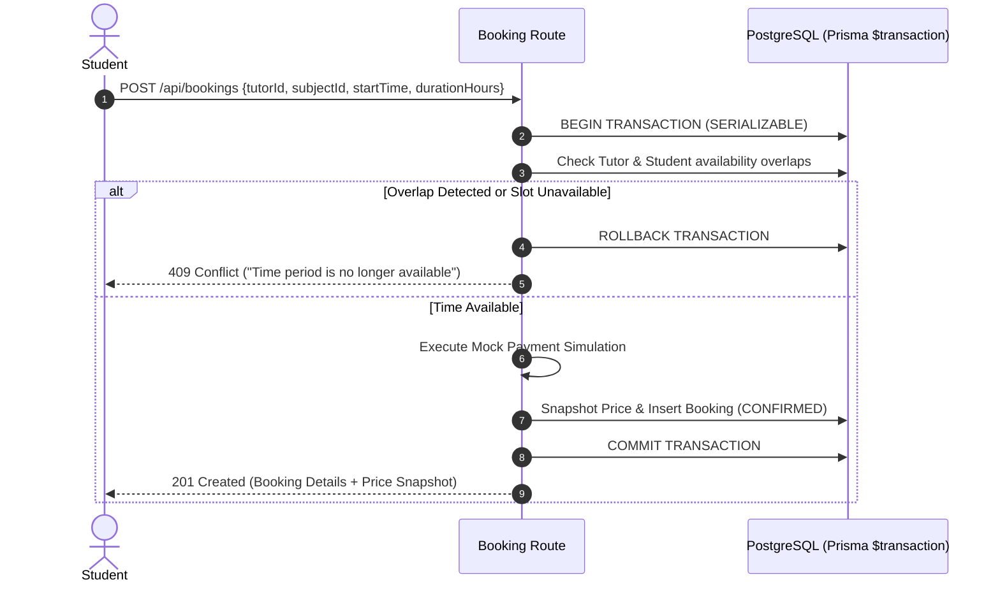

# System Design Specification (SDS) — TutorHub

**Version:** 2.0 (Aligned with SRS Draft 2)  
**Authors:** Korapin Manochokecharoen, Phureeruch Satithangkul  
**Course:** CPE 334  

---

## 1. Architecture Overview

TutorHub utilizes a modern **Client-Server** architecture designed for modularity, strict role-based access control, and transaction safety:

```mermaid
flowchart LR
    subgraph Client ["Client (Frontend)"]
        UI["React 18 + Vite + TS"]
        Bootstrap["Bootstrap UI Components"]
        Router["React Router"]
    end

    subgraph Server ["Server (Backend)"]
        Express["Express.js App"]
        AuthMid["authMiddleware (JWT)"]
        RoleMid["roleMiddleware (RBAC)"]
        TxMgr["Atomic Transaction Service"]
    end

    subgraph DataTier ["Data Tier"]
        Prisma["Prisma ORM"]
        Postgres[("PostgreSQL")]
    end

    Client -->|RESTful JSON / JWT| Express
    Express --> AuthMid
    AuthMid --> RoleMid
    RoleMid --> TxMgr
    TxMgr --> Prisma
    Prisma --> Postgres
```



* **Frontend (Client):** React 18, TypeScript, Vite, Bootstrap. Communicates with the backend exclusively via RESTful JSON APIs using bearer token authentication.
* **Backend (Server):** Node.js, Express.js, TypeScript. Enforces authentication, authorization, input validation, availability interval slicing, and pricing rules.
* **Database & ORM:** PostgreSQL managed via Prisma ORM for type-safe schema definitions, database migrations, and ACID-compliant transactional guarantees (`prisma.$transaction`).

---

## 2. Database Schema (Prisma)

The schema enforces core **Draft 2 business rules** directly at the data layer, including continuous availability intervals, duration-based bookings with price snapshots, mock payment tracking, tiered refunds, and review editing.

```prisma
datasource db {
  provider = "postgresql"
  url      = env("DATABASE_URL")
}

generator client {
  provider = "prisma-client-js"
}

// ---------------------------------------------------------------------------
// Enums
// ---------------------------------------------------------------------------

enum Role {
  STUDENT
  TUTOR
  ADMIN
}

enum BookingStatus {
  CONFIRMED
  CANCELLED
  COMPLETED
}

enum PaymentStatus {
  SUCCESS
  REFUNDED_PARTIAL
  REFUNDED_FULL
}

// ---------------------------------------------------------------------------
// User & Profile Models
// ---------------------------------------------------------------------------

model User {
  id              Int            @id @default(autoincrement())
  email           String         @unique
  password        String         // NFR-01, NFR-03: Salted hash (bcrypt)
  name            String
  role            Role           // BR-01: Exactly one role per account
  isEmailVerified Boolean        @default(false) // BR-02: Required before booking
  isApproved      Boolean        @default(false) // BR-02: Tutor accounts require Admin approval
  createdAt       DateTime       @default(now())
  updatedAt       DateTime       @updatedAt

  tutorProfile    TutorProfile?
  availabilities  Availability[] @relation("TutorAvailabilities")
  studentBookings Booking[]      @relation("StudentBookings")
  tutorBookings   Booking[]      @relation("TutorBookings")
  reviews         Review[]       @relation("StudentReviews")
}

model Subject {
  id          Int            @id @default(autoincrement())
  name        String         @unique
  description String?
  tutors      TutorSubject[]
  bookings    Booking[]
  createdAt   DateTime       @default(now())
}

model TutorProfile {
  id          Int            @id @default(autoincrement())
  userId      Int            @unique
  user        User           @relation(fields: [userId], references: [id], onDelete: Cascade)
  bio         String?
  hourlyPrice Float          // FR-05, BR-09: Hourly rate for booking calculation
  subjects    TutorSubject[]
  createdAt   DateTime       @default(now())
  updatedAt   DateTime       @updatedAt
}

model TutorSubject {
  id             Int          @id @default(autoincrement())
  tutorProfileId Int
  tutorProfile   TutorProfile @relation(fields: [tutorProfileId], references: [id], onDelete: Cascade)
  subjectId      Int
  subject        Subject      @relation(fields: [subjectId], references: [id], onDelete: Cascade)

  @@unique([tutorProfileId, subjectId])
}

// ---------------------------------------------------------------------------
// Availability & Booking Models
// ---------------------------------------------------------------------------

model Availability {
  id        Int      @id @default(autoincrement())
  tutorId   Int
  tutor     User     @relation("TutorAvailabilities", fields: [tutorId], references: [id], onDelete: Cascade)
  startTime DateTime // BR-04, BR-05: Starts on :00 or :30, 1-hour interval alignment
  endTime   DateTime // BR-04: Duration in whole hours (min 1 hour)
  createdAt DateTime @default(now())
  updatedAt DateTime @updatedAt

  @@index([tutorId, startTime, endTime])
}

model Booking {
  id                  Int           @id @default(autoincrement())
  studentId           Int
  student             User          @relation("StudentBookings", fields: [studentId], references: [id])
  tutorId             Int
  tutor               User          @relation("TutorBookings", fields: [tutorId], references: [id])
  subjectId           Int
  subject             Subject       @relation(fields: [subjectId], references: [id])
  startTime           DateTime      // BR-05: 1-hour interval from availability start
  endTime             DateTime      // BR-05: Whole hour duration
  durationHours       Int           // BR-05: Whole number of hours (1h, 2h, etc.)
  hourlyPriceSnapshot Float         // BR-09: Frozen hourly price at confirmation
  totalPrice          Float         // BR-09: durationHours * hourlyPriceSnapshot
  notes               String?       // Optional session notes from student
  lessonSummary       String?       // FR-13: Tutor lesson summary or homework
  status              BookingStatus @default(CONFIRMED)
  paymentStatus       PaymentStatus @default(SUCCESS) // FR-10: Mock payment status
  cancelledBy         Role?         // BR-11, BR-12: STUDENT or TUTOR
  cancelledAt         DateTime?
  refundPercentage    Int?          // BR-11: 100, 50, 0
  refundAmount        Float?        // BR-11: Calculated refund amount
  createdAt           DateTime      @default(now())
  updatedAt           DateTime      @updatedAt

  review              Review?

  @@index([studentId, startTime, endTime])
  @@index([tutorId, startTime, endTime])
}

// ---------------------------------------------------------------------------
// Review Model
// ---------------------------------------------------------------------------

model Review {
  id        Int      @id @default(autoincrement())
  bookingId Int      @unique // BR-14: Exactly one review per booking
  booking   Booking  @relation(fields: [bookingId], references: [id], onDelete: Cascade)
  studentId Int
  student   User     @relation("StudentReviews", fields: [studentId], references: [id])
  rating    Int      // FR-14: 1 to 5 stars
  comment   String   // Written review text
  createdAt DateTime @default(now())
  updatedAt DateTime @updatedAt // FR-14, BR-14: Review editing support
}
```

---

## 3. Core Business Logic & Transaction Design

### 3.1 Availability Slicing & No "Dead Fragments" (BR-04, BR-05, BR-06)
1. **Rule:** Tutors define availability blocks in whole hours starting at `:00` or `:30`.
2. **Booking Alignment:** Bookings must start on 1-hour intervals aligned with the availability start time and last a whole number of hours.
3. **Slicing:** When a booking is confirmed within an availability window $[T_{start}, T_{end}]$, the remaining available intervals are computed dynamically:
   - If booking $[B_{start}, B_{end}]$ leaves time before ($T_{start} < B_{start}$), interval $[T_{start}, B_{start}]$ remains available in whole hours.
   - If booking leaves time after ($B_{end} < T_{end}$), interval $[B_{end}, T_{end}]$ remains available in whole hours.
   - Since both availability and booking durations are whole hours and aligned, **no fractional (30-minute) fragments can exist**.

### 3.2 Concurrency Race Condition & Atomic Rollback (BR-08, NFR-04)
To prevent double booking without requiring client-side cart hold timers (Scope 4.2), the system executes booking confirmation and mock payment inside an **atomic Prisma transaction**:



### 3.3 3-Tier Cancellation & Interval Merging (BR-11, BR-12, BR-13)
* **Student Cancellation:**
  $$\text{Refund} = \begin{cases} 
  100\% & \text{if } t \ge 72\text{ hours} \\ 
  50\% & \text{if } 24\text{ hours} \le t < 72\text{ hours} \\ 
  0\% & \text{if } 0 < t < 24\text{ hours} 
  \end{cases}$$
  The released interval $[B_{start}, B_{end}]$ is restored and merged with any adjacent availability blocks for that tutor:
  $$\text{Interval}_{\text{merged}} = \text{MergeAdjacent}(\text{ExistingAvailabilities} \cup [B_{start}, B_{end}])$$
* **Tutor Cancellation:**
  Student receives a 100% refund. The time period $[B_{start}, B_{end}]$ is marked permanently cancelled and is **not** restored or merged for other students.

---

## 4. API Endpoint Specifications

### 4.1 Authentication & Account Management (Korapin)

#### `POST /api/auth/register`
* **Access:** Public
* **Request:** `{ email: string, password: string, name: string }`
* **Response (201):** `{ message: "Student registered successfully. Please verify your email.", userId: number }`
* **Errors:** `400 Bad Request` (Invalid email/password format), `409 Conflict` (Email already registered).

#### `POST /api/auth/login`
* **Access:** Public
* **Request:** `{ email: string, password: string }`
* **Response (200):** `{ token: string, user: { id: number, email: string, name: string, role: Role, isEmailVerified: boolean, isApproved: boolean } }`
* **Errors:** `401 Unauthorized` (Invalid credentials).

#### `POST /api/auth/verify-email`
* **Access:** Requires Auth (Student)
* **Request:** `{}`
* **Response (200):** `{ message: "Email verified successfully.", isEmailVerified: true }`

#### `POST /api/auth/reset-password`
* **Access:** Public
* **Request:** `{ email: string, newPassword: string }`
* **Response (200):** `{ message: "Password reset successful." }`

---

### 4.2 Tutor Profile & Availability Management (Korapin)

#### `POST /api/tutor/availability`
* **Access:** Requires `TUTOR` role
* **Request:** `{ startTime: ISO8601, endTime: ISO8601 }`
* **Response (201):** Created `Availability` object.
* **Validation (BR-04, BR-05):**
  - Duration must be $\ge 1\text{ hour}$ and a whole number of hours.
  - `startTime` must begin on `:00` or `:30`.
  - `startTime` must be in the future.
* **Errors:** `400 Bad Request` (Invalid interval/past timestamp), `403 Forbidden` (Non-tutor).

#### `GET /api/availability`
* **Access:** Public / Authenticated
* **Query Params:** `?subjectId=number&tutorId=number&date=YYYY-MM-DD`
* **Response (200):** Array of available continuous time intervals per tutor with hourly pricing.

#### `DELETE /api/tutor/availability/:id`
* **Access:** Requires `TUTOR` role (ownership verified)
* **Response (200):** `{ message: "Availability period removed." }`
* **Errors:** `400 Bad Request` (Cannot delete interval with existing confirmed bookings).

#### `PUT /api/tutor/profile`
* **Access:** Requires `TUTOR` role
* **Request:** `{ bio?: string, hourlyPrice: number, subjectIds: number[] }`
* **Response (200):** Updated `TutorProfile`.

---

### 4.3 Booking & Mock Payment (Phureeruch)

#### `POST /api/bookings`
* **Access:** Requires `STUDENT` role
* **Pre-conditions (BR-02):** `student.isEmailVerified === true`.
* **Request:**
  ```json
  {
    "tutorId": 1,
    "subjectId": 2,
    "startTime": "2026-11-10T10:00:00.000Z",
    "durationHours": 2,
    "notes": "Need help preparing for midterm exam."
  }
  ```
* **Processing:**
  1. Validate start time alignment (1-hour step from availability block start, `:00` or `:30`).
  2. Verify target interval fits entirely within an active `Availability` record.
  3. Verify no overlapping confirmed bookings exist for the Tutor or the Student (BR-07).
  4. Execute mock payment simulation.
  5. Snapshot `hourlyPrice` and calculate `totalPrice = hourlyPrice * durationHours`.
  6. Insert `Booking` record with `CONFIRMED` status.
* **Response (201):** Confirmed `Booking` object including frozen price snapshot.
* **Errors:**
  - `400 Bad Request` (Unverified email, past date, non-whole hour duration).
  - `409 Conflict` (Concurrent booking overlap or slot unavailable).

#### `GET /api/bookings`
* **Access:** Requires Auth
* **Filtering (NFR-02):**
  - `STUDENT`: Returns bookings where `studentId === currentUserId`.
  - `TUTOR`: Returns bookings where `tutorId === currentUserId`.
  - `ADMIN`: Returns all bookings school-wide.
* **Response (200):** Array of bookings with tutor, student, subject, and status details.

#### `GET /api/bookings/:id`
* **Access:** Requires Auth (Ownership check: Student, Tutor, or Admin).
* **Response (200):** Booking detail.

---

### 4.4 Booking Lifecycle & Cancellation (Phureeruch — Sprint 2)

#### `PATCH /api/bookings/:id/cancel`
* **Access:** Requires Auth (Student or Tutor ownership)
* **Request:** `{ reason?: string }`
* **Processing:**
  - Verify booking is in `CONFIRMED` status and `startTime > now()`.
  - If initiated by **Student**:
    - Calculate hours remaining until `startTime`.
    - Apply BR-11: 100% refund ($\ge 72\text{h}$), 50% refund ($[24\text{h}, 72\text{h})$), or 0% ($< 24\text{h}$).
    - Set `status = CANCELLED`, `cancelledBy = STUDENT`, `refundPercentage`, `refundAmount`.
    - Execute interval merging (BR-13) restoring available time.
  - If initiated by **Tutor**:
    - Apply BR-12: 100% refund to student.
    - Set `status = CANCELLED`, `cancelledBy = TUTOR`, `refundPercentage = 100`.
    - Cancelled time is **not** restored to availability.
* **Response (200):** `{ message: "Booking cancelled successfully.", refundPercentage: number, refundAmount: number }`

---

### 4.5 Lesson Completion & Reviews (Sprint 3)

#### `PATCH /api/bookings/:id/complete` (Korapin)
* **Access:** Requires `TUTOR` role (Tutor ownership)
* **Request:** `{ lessonSummary: string }`
* **Response (200):** Updated booking with `status = COMPLETED`.

#### `POST /api/reviews` (Phureeruch)
* **Access:** Requires `STUDENT` role
* **Request:** `{ bookingId: number, rating: number, comment: string }`
* **Validation (BR-14):**
  - Booking must have `status === COMPLETED`.
  - Must not already have an existing review (`@@unique([bookingId])`).
  - `rating` must be an integer between 1 and 5.
* **Response (201):** Created `Review`.

#### `PUT /api/reviews/:id` (Phureeruch)
* **Access:** Requires `STUDENT` role (Review ownership)
* **Request:** `{ rating: number, comment: string }`
* **Response (200):** Updated `Review` object with fresh `updatedAt` timestamp.

#### `GET /api/tutors/:id/reviews` (Korapin)
* **Access:** Public / Authenticated
* **Response (200):** `{ averageRating: number, reviewCount: number, reviews: Review[] }`

---

### 4.6 Admin Oversight API (Korapin — Sprint 2)

#### `GET /api/admin/tutors/pending`
* **Access:** Requires `ADMIN` role
* **Response (200):** Array of unapproved Tutor accounts (`isApproved: false`).

#### `PATCH /api/admin/tutors/:id/approve`
* **Access:** Requires `ADMIN` role
* **Response (200):** `{ message: "Tutor approved successfully.", isApproved: true }`

#### `POST /api/admin/subjects`
* **Access:** Requires `ADMIN` role
* **Request:** `{ name: string, description?: string }`
* **Response (201):** Created `Subject`.
