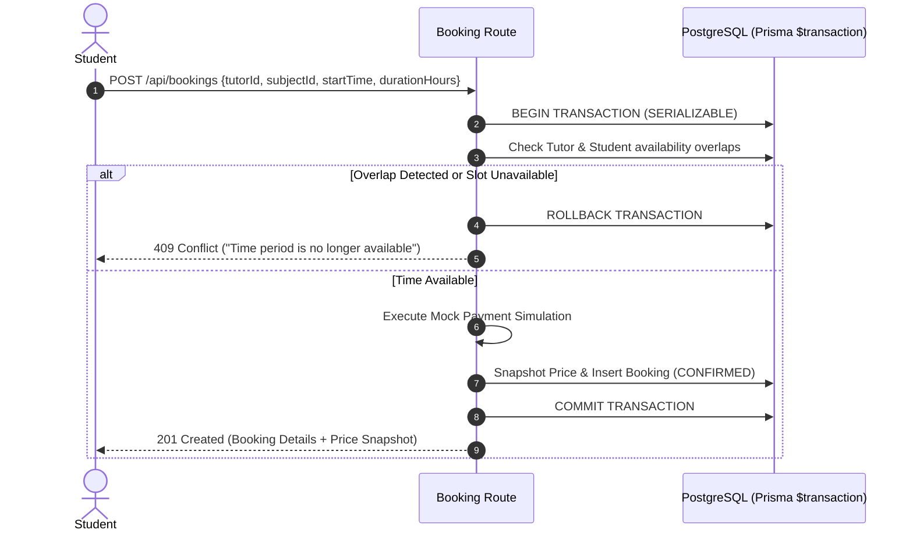

# System Design Specification (SDS) — TutorHub

**Version:** 2.1 (Updated for Lab 7 Adaptive Maintenance `CHG-03` / Issue `#54`)  
**Authors:** Korapin Manoprasertkoon, Phureeruch Satithangkul  
**Course:** CPE 334  

---

## 1. Architecture Overview

TutorHub utilizes a modern **Client-Server** architecture designed for modularity, strict role-based access control, and transaction safety:


* **Frontend (Client):** React 19, TypeScript, Vite, Bootstrap. Communicates with the backend exclusively via RESTful JSON APIs using bearer token authentication.
* **Backend (Server):** Node.js, Express.js, TypeScript. Enforces authentication, authorization, input validation, availability interval slicing, and pricing rules.
* **Database & ORM:** PostgreSQL managed via Prisma ORM for type-safe schema definitions, database migrations, and ACID-compliant transactional guarantees (`prisma.$transaction`).

---

## 2. Database Schema (Prisma)

The schema enforces core **Draft 2 business rules** directly at the data layer, including continuous availability intervals, duration-based bookings with price snapshots, mock payment tracking, tiered refunds, and review editing.

```prisma
generator client {
  provider = "prisma-client-js"
}

datasource db {
  provider = "postgresql"
}

// ---------------------------------------------------------------------------
// Enums
// ---------------------------------------------------------------------------

enum Role {
  STUDENT
  TUTOR
  ADMIN
}

enum BookingStatus {
  CONFIRMED
  CANCELLED
  COMPLETED
}

enum PaymentStatus {
  SUCCESS
  REFUNDED_PARTIAL
  REFUNDED_FULL
}

enum TeachingLevel {
  HIGH_SCHOOL
  UNDERGRADUATE
  GRADUATE
}

// ---------------------------------------------------------------------------
// User & Profile Models
// ---------------------------------------------------------------------------

model User {
  id              Int                 @id @default(autoincrement())
  email           String              @unique
  password        String              // NFR-01, NFR-03: Salted hash (bcrypt)
  name            String
  role            Role                // BR-01: Exactly one role per account
  isEmailVerified Boolean             @default(false) // BR-02: Required before booking
  isApproved      Boolean             @default(false) // BR-02: Tutor accounts require Admin approval
  createdAt       DateTime            @default(now())
  updatedAt       DateTime            @updatedAt

  tutorProfile    TutorProfile?
  availabilities  Availability[]      @relation("TutorAvailabilities")
  studentBookings Booking[]           @relation("StudentBookings")
  tutorBookings   Booking[]           @relation("TutorBookings")
  reviews         Review[]            @relation("StudentReviews")
  uploads         BookingAttachment[] @relation("UploadedAttachments")
}

model Subject {
  id          Int            @id @default(autoincrement())
  name        String         @unique
  description String?
  tutors      TutorSubject[]
  bookings    Booking[]
  createdAt   DateTime       @default(now())
}

model TutorProfile {
  id        Int            @id @default(autoincrement())
  userId    Int            @unique
  user      User           @relation(fields: [userId], references: [id], onDelete: Cascade)
  bio       String?
  subjects  TutorSubject[]
  createdAt DateTime       @default(now())
  updatedAt DateTime       @updatedAt
}

model TutorSubject {
  id             Int             @id @default(autoincrement())
  tutorProfileId Int
  tutorProfile   TutorProfile    @relation(fields: [tutorProfileId], references: [id], onDelete: Cascade)
  subjectId      Int
  subject        Subject         @relation(fields: [subjectId], references: [id], onDelete: Cascade)
  hourlyPrice    Decimal         @db.Decimal(10, 2) // FR-05, BR-09 source (THB, > 0)
  levels         TeachingLevel[] @default([])
  topics         String?         @db.VarChar(200)

  @@unique([tutorProfileId, subjectId])
}

// ---------------------------------------------------------------------------
// Availability, Booking & Attachment Models
// ---------------------------------------------------------------------------

model Availability {
  id        Int      @id @default(autoincrement())
  tutorId   Int
  tutor     User     @relation("TutorAvailabilities", fields: [tutorId], references: [id], onDelete: Cascade)
  startTime DateTime // BR-04, BR-05: Starts on :00 or :30, 1-hour interval alignment
  endTime   DateTime // BR-04: Duration in whole hours (min 1 hour)
  createdAt DateTime @default(now())
  updatedAt DateTime @updatedAt

  @@index([tutorId, startTime, endTime])
}

model Booking {
  id                  Int                 @id @default(autoincrement())
  studentId           Int
  student             User                @relation("StudentBookings", fields: [studentId], references: [id])
  tutorId             Int
  tutor               User                @relation("TutorBookings", fields: [tutorId], references: [id])
  subjectId           Int
  subject             Subject             @relation(fields: [subjectId], references: [id])
  startTime           DateTime            // BR-05: 1-hour interval from availability start
  endTime             DateTime            // BR-05: Whole hour duration
  durationHours       Int                 // BR-05: Whole number of hours (1h, 2h, etc.)
  hourlyPriceSnapshot Decimal             @db.Decimal(10, 2) // BR-09: Frozen hourly price at confirmation
  totalPrice          Decimal             @db.Decimal(10, 2) // BR-09: durationHours * hourlyPriceSnapshot
  notes               String?             // Optional session notes from student
  lessonSummary       String?             // FR-13: Tutor lesson summary or homework
  status              BookingStatus       @default(CONFIRMED)
  paymentStatus       PaymentStatus       @default(SUCCESS) // FR-10: Mock payment status
  cancelledBy         Role?               // BR-11, BR-12: STUDENT or TUTOR
  cancelledAt         DateTime?
  refundPercentage    Int?                // BR-11: 100, 50, 0
  refundAmount        Decimal?            @db.Decimal(10, 2) // BR-11: Calculated refund amount
  createdAt           DateTime            @default(now())
  updatedAt           DateTime            @updatedAt

  review              Review?
  attachments         BookingAttachment[]

  @@index([studentId, startTime, endTime])
  @@index([tutorId, startTime, endTime])
}

model BookingAttachment {
  id           Int      @id @default(autoincrement())
  bookingId    Int?     // Null until linked inside the booking confirmation transaction
  booking      Booking? @relation(fields: [bookingId], references: [id], onDelete: Cascade)
  uploadedById Int
  uploadedBy   User     @relation("UploadedAttachments", fields: [uploadedById], references: [id])
  fileName     String
  mimeType     String
  sizeBytes    Int
  storageKey   String   @unique
  fileData     Bytes?   // Lab 5 DB-backed attachment storage (BYTEA)
  createdAt    DateTime @default(now())

  @@index([bookingId])
  @@index([uploadedById, bookingId])
}

// ---------------------------------------------------------------------------
// Review Model
// ---------------------------------------------------------------------------

model Review {
  id        Int      @id @default(autoincrement())
  bookingId Int      @unique // BR-14: Exactly one review per booking
  booking   Booking  @relation(fields: [bookingId], references: [id], onDelete: Cascade)
  studentId Int
  student   User     @relation("StudentReviews", fields: [studentId], references: [id])
  rating    Int      // FR-14: 1 to 5 stars
  comment   String   // Written review text
  createdAt DateTime @default(now())
  updatedAt DateTime @updatedAt // FR-14, BR-14: Review editing support
}
```

> **Note:** Monetary columns (`hourlyPrice`, `hourlyPriceSnapshot`, `totalPrice`, `refundAmount`) use `Decimal(10, 2)` in PostgreSQL (Thai baht) and are serialized as JSON `number` values in API responses. Non-overlapping tutor/student booking guarantees are enforced at the database level via GiST exclusion constraints (`booking_tutor_no_overlap`, `booking_student_no_overlap`).

---

## 3. Core Business Logic & Transaction Design

### 3.1 Availability Slicing & No "Dead Fragments" (BR-04, BR-05, BR-06)
1. **Rule:** Tutors define availability blocks in whole hours starting at `:00` or `:30`.
2. **Booking Alignment:** Bookings must start on 1-hour intervals aligned with the availability start time and last a whole number of hours.
3. **Slicing:** When a booking is confirmed within an availability window $[T_{start}, T_{end}]$, the remaining available intervals are computed dynamically:
   - If booking $[B_{start}, B_{end}]$ leaves time before ($T_{start} < B_{start}$), interval $[T_{start}, B_{start}]$ remains available in whole hours.
   - If booking leaves time after ($B_{end} < T_{end}$), interval $[B_{end}, T_{end}]$ remains available in whole hours.
   - Since both availability and booking durations are whole hours and aligned, **no fractional (30-minute) fragments can exist**.

### 3.2 Concurrency Race Condition & Atomic Rollback (BR-08, NFR-04)
To prevent double booking without requiring client-side cart hold timers (Scope 4.2), the system executes booking confirmation and mock payment inside an **atomic Prisma transaction**:



### 3.3 3-Tier Cancellation & Interval Merging (BR-11, BR-12, BR-13)
* **Student Cancellation:**
  $$\text{Refund} = \begin{cases} 
  100\% & \text{if } t \ge 72\text{ hours} \\ 
  50\% & \text{if } 24\text{ hours} \le t < 72\text{ hours} \\ 
  0\% & \text{if } 0 < t < 24\text{ hours} 
  \end{cases}$$
  The released interval $[B_{start}, B_{end}]$ is restored and merged with any adjacent availability blocks for that tutor:
  $$\text{Interval}_{\text{merged}} = \text{MergeAdjacent}(\text{ExistingAvailabilities} \cup [B_{start}, B_{end}])$$
* **Tutor Cancellation:**
  Student receives a 100% refund. The time period $[B_{start}, B_{end}]$ is marked permanently cancelled and is **not** restored or merged for other students.

### 3.4 Multi-Hour Bundle Pricing, Lead-Time Cutoffs & Daily Capacity Policy (BR-04, BR-05, BR-09 — `CHG-03`)
1. **3-Tier Multi-Hour Bundle Discount (`BR-09`, `FR-10`):**
   - `calculateBookingPrice({ hourlyPrice, durationHours })` enforces `hourlyPrice > 0` and integer `durationHours` in `1..4`.
   - Discount tiers applied to frozen `totalPrice` (`Decimal(10, 2)`):
     - `durationHours === 1`: **0% discount** (`multiplier = 1.00`)
     - `durationHours === 2`: **5% discount** (`multiplier = 0.95`)
     - `durationHours === 3` or `4`: **10% discount** (`multiplier = 0.90`)
   - `basePrice = round2(hourlyPrice * durationHours)`, `totalPrice = round2(hourlyPrice * durationHours * multiplier)`, and `discountAmount = round2(basePrice - totalPrice)`.
   - `Booking.hourlyPriceSnapshot` stores the frozen base hourly rate while `Booking.totalPrice` stores the frozen post-discount total. Downstream cancellation refunds (`BR-11`, `BR-12`) and Admin retained revenue (`DEF-08`) compute directly from `Booking.totalPrice`.
2. **2-Hour Advance Booking Cutoff & 4-Hour Max Single-Booking Cap (`BR-05`, `FR-08`):**
   - `validateBookingTime()` and `createBookingAttempt()` require `startTime.getTime() - now.getTime() >= 2 * 60 * 60 * 1000` (`>= 120 minutes`); requests within `< 2 hours` of start return `400 "Bookings must be made at least 2 hours before the lesson starts."`
   - Single bookings with `durationHours > 4` return `400 "A single booking cannot exceed 4 hours."`
3. **1-Hour Tutor Availability Notice & 8-Hour Daily Teaching Capacity (`BR-04`, `FR-06`):**
   - `validateAvailabilityWindow()` requires `startTime.getTime() - now.getTime() >= 60 * 60 * 1000` (`>= 60 minutes`, else `400 "Availability must start at least 1 hour in the future."`) and single-window duration in `1..8` whole hours.
   - Inside the `Serializable` transaction in `createAvailability()` and `updateAvailability()`, for each local calendar day (`Asia/Bangkok`, `UTC+7`) overlapped by `[startTime, endTime)`, the service sums overlapping durations of open `Availability` rows (excluding `availabilityId` on `PUT`), non-cancelled `Booking` rows (`status !== 'CANCELLED'`), and `[startTime, endTime)`. If any Bangkok calendar day exceeds `8 hours`, the transaction rolls back with `400 "Daily tutor availability and booked lessons cannot exceed 8 hours per day."`

---

## 4. API Endpoint Specifications

### 4.1 Authentication & Account Management (Korapin)

#### `POST /api/auth/register`
* **Access:** Public
* **Request:** `{ email: string, password: string, name: string }`
* **Response (201):** `{ message: "Registration successful. Please verify your email.", userId: number, token: string, user: UserPublic }`
* **Errors:** `400 Bad Request` (Invalid email/password/name), `409 Conflict` (Email already registered).

#### `POST /api/auth/login`
* **Access:** Public
* **Request:** `{ email: string, password: string }`
* **Response (200):** `{ token: string, user: { id: number, email: string, name: string, role: Role, isEmailVerified: boolean, isApproved: boolean } }`
* **Errors:** `401 Unauthorized` (Invalid credentials).

#### `GET /api/auth/me`
* **Access:** Requires Auth
* **Response (200):** `{ user: UserPublic }`

#### `POST /api/auth/verify-email`
* **Access:** Requires Auth
* **Request:** `{}`
* **Response (200):** `{ message: "Email verified successfully.", isEmailVerified: true, user: UserPublic }`

#### `POST /api/auth/reset-password`
* **Access:** Public
* **Request:** `{ email: string, newPassword: string }`
* **Response (200):** `{ message: "If the account exists, the password has been reset." }`

---

### 4.2 Tutor Profile, Discovery & Availability Management (Korapin)

#### `GET /api/subjects`
* **Access:** Public / Authenticated
* **Response (200):** Array of `Subject` objects ordered by `id`.

#### `GET /api/tutors`
* **Access:** Public / Authenticated
* **Response (200):** Array of `{ id: number, name: string }` for approved tutors.

#### `GET /api/tutor/profile`
* **Access:** Requires `TUTOR` role
* **Response (200):** `{ user, profile, subjects }` where `subjects` includes `{ id, name, description, createdAt, hourlyPrice, levels, topics }`.

#### `PUT /api/tutor/profile`
* **Access:** Requires `TUTOR` role
* **Request:** `{ bio?: string, subjects: [{ subjectId: number, hourlyPrice: number, levels?: TeachingLevel[], topics?: string | null }] }`
* **Response (200):** Updated `{ user, profile, subjects }` (without affecting existing bookings' frozen prices).

#### `GET /api/tutor/availability`
* **Access:** Requires `TUTOR` role
* **Response (200):** `{ availabilities: Availability[], bookings: BookingDTO[] }` for open and booked windows ending in the future.

#### `POST /api/tutor/availability`
* **Access:** Requires `TUTOR` role (`isApproved === true`)
* **Request:** `{ startTime: ISO8601, endTime: ISO8601 }`
* **Response (201):** Created (or auto-merged adjacent) `Availability` object.
* **Validation (BR-04, BR-05 — `CHG-03`):**
  - Duration must be between `1` and `8` whole hours.
  - `startTime` must begin on `:00` or `:30` and be at least **1 hour (`60 minutes`) in the future** (`startTime - now >= 1h`).
  - Must not overlap existing availability or non-cancelled bookings.
  - Combined open availability hours + non-cancelled booked lesson hours on the target `Asia/Bangkok` (`UTC+7`) calendar day must not exceed **8 hours**.
* **Errors:** `400 Bad Request` (Invalid interval, `< 1h` advance lead-time, overlap, or `> 8h` daily capacity), `403 Forbidden` (Non-tutor or unapproved tutor).

#### `GET /api/availability`
* **Access:** Public / Authenticated
* **Query Params:** `?subjectId=number&tutorId=number&date=YYYY-MM-DD&level=HIGH_SCHOOL|UNDERGRADUATE|GRADUATE&startHour=HH:00|HH:30&endHour=HH:00|HH:30`
* **Filtering & Validation (F-09, AC-09.1–AC-09.4, STS-09.1–STS-09.4):**
  - Filters by subject ID, specific tutor ID, local calendar date (`YYYY-MM-DD` in `Asia/Bangkok`), and teaching level.
  - Optional `startHour` and `endHour` constrain returned availability slots to windows falling entirely within the requested Bangkok time range.
  - Validation requires `startHour` and `endHour` to fall on the `:00` or `:30` grid with `endHour > startHour` spanning at least 1 whole hour (`400 Bad Request` if malformed or reversed).
* **Response (200):** Array of approved tutor listings `{ user, profile, subjects, availabilities }` with future bookable slots.

#### `DELETE /api/tutor/availability/:id`
* **Access:** Requires `TUTOR` role (ownership verified)
* **Response (200):** `{ message: "Availability removed successfully." }`
* **Errors:** `400 Bad Request` (Cannot delete interval with existing confirmed bookings), `403 Forbidden` (Not owner), `404 Not Found`.

---

### 4.3 Bookings, Lecture Attachments & Mock Payment (Phureeruch)

#### `POST /api/attachments`
* **Access:** Requires `STUDENT` role
* **Request:** `multipart/form-data` (field `file`) or JSON metadata `{ name: string, size: number, type: string }`
* **Validation:** File size `<= 20 MB`; allowed MIME types (PDF, PPT/PPTX, DOC/DOCX, TXT, PNG/JPG/GIF/WEBP).
* **Response (201):** `{ id: number, name: string, size: number, type: string }`

#### `GET /api/attachments/:id`
* **Access:** Requires Auth (Uploader, booking Student/Tutor, or Admin)
* **Response (200):** Streams file with `Content-Disposition: attachment` (or returns metadata JSON if uploaded as metadata-only).

#### `POST /api/bookings`
* **Access:** Requires `STUDENT` role
* **Pre-conditions (BR-02):** `student.isEmailVerified === true`.
* **Request:**
  ```json
  {
    "tutorId": 1,
    "subjectId": 2,
    "startTime": "2026-11-10T10:00:00.000Z",
    "durationHours": 2,
    "notes": "Need help preparing for midterm exam.",
    "attachmentIds": [12]
  }
  ```
* **Processing:**
  1. Validate start time alignment (1-hour step from availability block start, `:00` or `:30`), **2-hour minimum advance cutoff** (`startTime - now >= 2h`), **1..4 whole-hour duration cap** (`BR-05`), and optional lecture attachments (<= 5 files).
  2. Verify target interval fits entirely within an active `Availability` record.
  3. Verify no overlapping confirmed bookings exist for the Tutor or the Student (BR-07).
  4. Execute mock payment simulation.
  5. Snapshot chosen `TutorSubject.hourlyPrice` (`hourlyPriceSnapshot`) and calculate discounted `totalPrice` (`0%` off for `1h`, `5%` off for `2h`, `10%` off for `3h–4h` per `BR-09` / `CHG-03A`).
  6. Insert `Booking` record with `CONFIRMED` status, link/create attachments, and slice remaining availability (BR-06) inside a `Serializable` transaction.
* **Response (201):** Confirmed `Booking` DTO including embedded `student`, `tutor`, `subject`, `attachments`, `currentHourlyPrice`, and frozen price snapshot.
* **Errors:**
  - `400 Bad Request` (Unverified email, `< 2h` advance lead-time, non-whole hour or `> 4h` duration, invalid attachments).
  - `409 Conflict` (Concurrent booking overlap or slot unavailable).

#### `GET /api/bookings`
* **Access:** Requires Auth
* **Filtering (NFR-02):**
  - `STUDENT`: Returns bookings where `studentId === currentUserId`.
  - `TUTOR`: Returns bookings where `tutorId === currentUserId`.
  - `ADMIN`: Returns all bookings school-wide.
* **Response (200):** Array of booking DTOs with embedded student, tutor, subject, attachments, and status details.

#### `GET /api/bookings/:id`
* **Access:** Requires Auth (Ownership check: Student, Tutor, or Admin).
* **Response (200):** Booking DTO detail.

---

### 4.4 Booking Lifecycle & Cancellation (Phureeruch — Sprint 2)

#### `PATCH /api/bookings/:id/cancel`
* **Access:** Requires Auth (Student or Tutor ownership)
* **Request:** `{ reason?: string }`
* **Processing:**
  - Verify booking is in `CONFIRMED` status and `startTime > now()`.
  - If initiated by **Student**:
    - Calculate hours remaining until `startTime`.
    - Apply BR-11: 100% refund ($\ge 72\text{h}$), 50% refund ($[24\text{h}, 72\text{h})$), or 0% ($< 24\text{h}$).
    - Set `status = CANCELLED`, `cancelledBy = STUDENT`, `refundPercentage`, `refundAmount`.
    - Execute interval merging (BR-13) restoring available time.
  - If initiated by **Tutor**:
    - Apply BR-12: 100% refund to student.
    - Set `status = CANCELLED`, `cancelledBy = TUTOR`, `refundPercentage = 100`.
    - Cancelled time is **not** restored to availability.
* **Response (200):** `{ message: "Booking cancelled successfully.", refundPercentage: number, refundAmount: number }`

---

### 4.5 Lesson Completion & Reviews (Sprint 3)

#### `PATCH /api/bookings/:id/complete` (Korapin — Deliverable 2 Part C, F-16)
* **Access:** Requires `TUTOR` role (ownership verified: `booking.tutorId === currentUserId`)
* **Request:** `{ lessonSummary: string }`
* **Validation & Status Guards (FR-13, BR-14, AC-16.1–AC-16.6, STS-16.1–STS-16.5):**
  - Actor role must be `TUTOR` and match `booking.tutorId` (`403 Forbidden` if student, admin, or unauthorized tutor).
  - Booking must be in `CONFIRMED` status (`409 Conflict` if already `CANCELLED` or `COMPLETED`).
  - `lessonSummary` must be a non-empty trimmed string between 1 and 2,000 characters (`400 Bad Request` if missing, whitespace-only, or > 2,000 characters).
* **Cross-Feature Guard:**
  - Sets `booking.status = COMPLETED` and persists `booking.lessonSummary`.
  - Once completed, the booking is locked: subsequent `PATCH /api/bookings/:id/cancel` attempts by either Student or Tutor return `409 Conflict` ("Booking is not confirmed").
* **Response (200):** Updated booking object with `status = "COMPLETED"`, `lessonSummary`, and related models.
* **Errors:** `400 Bad Request` (Invalid summary), `403 Forbidden` (Role or ownership violation), `404 Not Found` (Booking does not exist), `409 Conflict` (Status is not CONFIRMED).

#### `POST /api/reviews` (Phureeruch)
* **Access:** Requires `STUDENT` role
* **Request:** `{ bookingId: number, rating: number, comment: string }`
* **Validation (BR-14):**
  - Booking must have `status === COMPLETED`.
  - Must not already have an existing review (`@@unique([bookingId])`).
  - `rating` must be an integer between 1 and 5.
* **Response (201):** Created `Review`.

#### `PUT /api/reviews/:id` (Phureeruch)
* **Access:** Requires `STUDENT` role (Review ownership)
* **Request:** `{ rating: number, comment: string }`
* **Response (200):** Updated `Review` object with fresh `updatedAt` timestamp.

#### `GET /api/tutors/:id/reviews` (Korapin)
* **Access:** Public / Authenticated
* **Response (200):** `{ averageRating: number, reviewCount: number, reviews: Review[] }`

---

### 4.6 Admin Oversight API (Korapin — Sprint 1 & Sprint 2)

#### `GET /api/admin/summary` (Sprint 1)
* **Access:** Requires `ADMIN` role
* **Response (200):** `{ totalBookings: number, mockRevenue: number, activeTutors: number, verifiedStudents: number, totalStudents: number }`

#### `GET /api/admin/tutors/pending` (Sprint 2)
* **Access:** Requires `ADMIN` role
* **Response (200):** Array of unapproved Tutor accounts (`isApproved: false`).

#### `PATCH /api/admin/tutors/:id/approve`
* **Access:** Requires `ADMIN` role
* **Response (200):** `{ message: "Tutor approved successfully.", isApproved: true }`

#### `POST /api/admin/subjects`
* **Access:** Requires `ADMIN` role
* **Request:** `{ name: string, description?: string }`
* **Response (201):** Created `Subject`.
